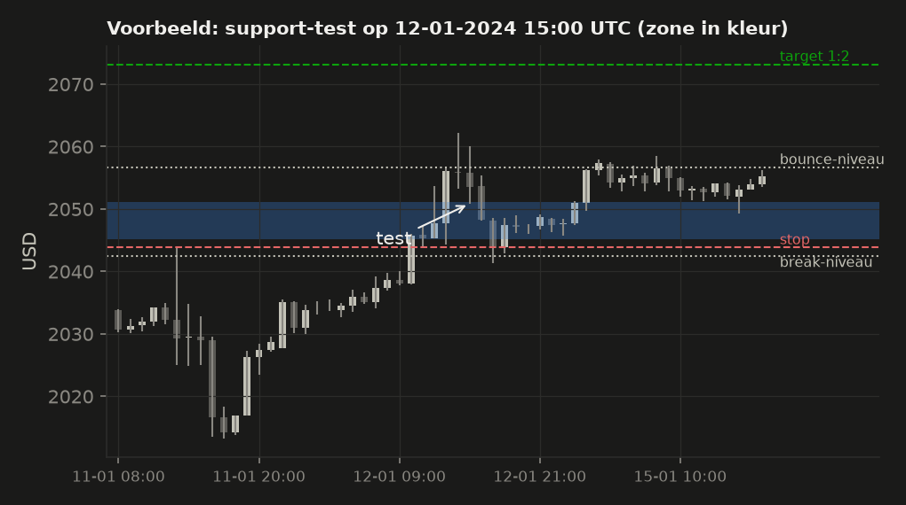
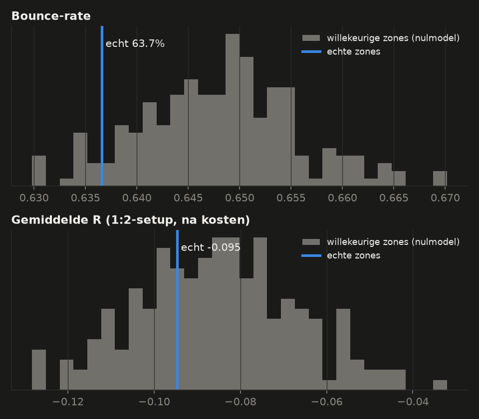
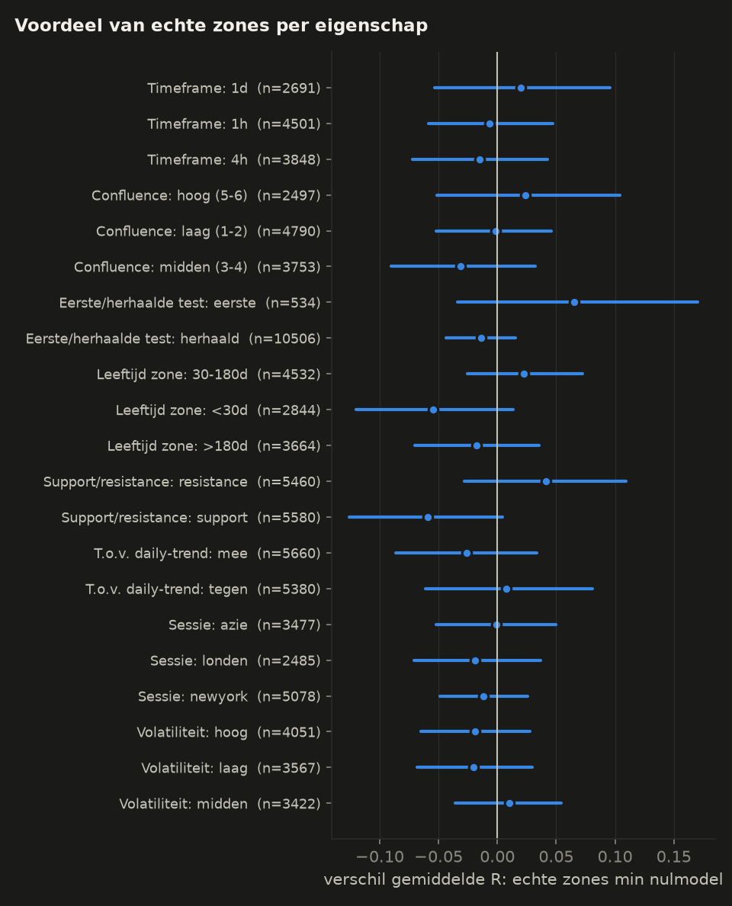
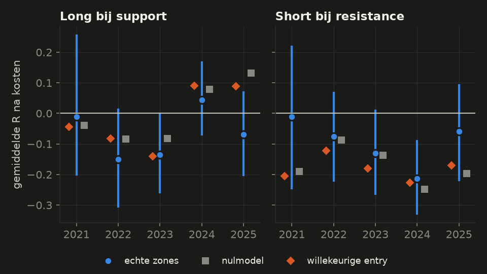
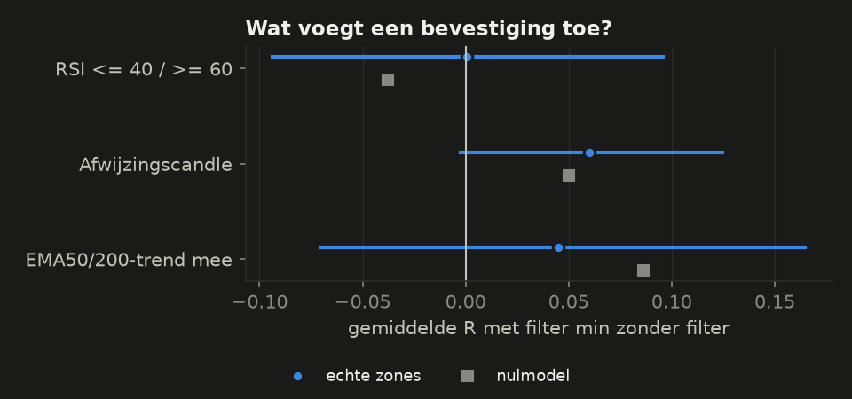

# Onderzoek: wat werkt er echt aan support/resistance op goud?

_Research-periode 2021-10-03 t/m 2025-09-26 (XAUUSD spot, 1h). Hold-out (laatste 12 maanden) niet gebruikt. Opzet vooraf vastgelegd in [PLAN.md](PLAN.md)._

## Samenvatting in gewone taal

**Kort: in deze data voorspellen S/R-zones op goud (1h) niets wat willekeurige niveaus
niet ook doen.** Dat is een geldige uitkomst. De meting is vooraf vastgelegd en niet
achteraf aangepast.

**Wat niet werkt**
- **Zones tegenover willekeurige niveaus (vraag 1).** Bij de echte zones ging de koers in
  63.7% van de 12.444 tests 1 ATR terug ("bounce"). Bij precies dezelfde zones,
  verschoven naar willekeurige plekken, was dat 64.8%. De echte zones scoren
  dus niet beter, eerder iets slechter (percentiel 8 van het nulmodel). Een
  vaste 1:2-trade op elke test leverde gemiddeld **-0.095 R** op na kosten. Bij
  willekeurige niveaus was dat -0.085 R. Vóór kosten is het ongeveer 0: je wint niets
  en betaalt spread.
- **Geen enkele eigenschap maakt het verschil (vraag 2).** Timeframe, confluence,
  leeftijd, sessie en volatiliteit leveren geen groep op waar echte zones aantoonbaar
  beter zijn dan willekeurige niveaus.
- **Methode B** (KDE) doet het niet beter dan A.
- **Na een doorbraak** komt de koers vaak terug naar de zone (83.1%). Dat gebeurt
  echter bijna net zo vaak bij willekeurige niveaus (81.4%), en handelen op
  die retest levert niets op.
- **Bevestigingen (RSI, afwijzingscandle, EMA-trend)** voegen niets toe dat specifiek
  met de zone te maken heeft.

**Wat wél zichtbaar is (maar niets met zones te maken heeft)**
- **De trend van goud domineert.** Goud steeg in de research-periode +121%.
  Willekeurige long-trades kwamen na kosten op ongeveer 0 R uit, willekeurige shorts op
  ongeveer −0,18 R. Een long-strategie ziet er daardoor al snel beter uit dan hij is.
- **Een afwijzingscandle helpt een beetje** (+0,06 R). Dat helpt even goed bij
  willekeurige niveaus, dus het is een candle-effect en geen zone-effect.

**Wat onzeker is**
- Kleine effecten kan deze data niet uitsluiten: over alle tests samen tot ongeveer
  ±0,03 R per trade, in kleinere subgroepen tot ±0,1 R.
- Een paar groepen wijzen voorzichtig de goede kant op, maar hun intervallen bevatten
  nul: de *eerste* test van een zone (+0,07 R t.o.v. het nulmodel), resistance-zones
  (+0,04 R) en daily/hoge-confluence-zones (+0,02 R). Bij ruim twintig opsplitsingen
  verwacht je zulke uitschieters ook door toeval.
- Alles hier gaat over deze zone-definitie (fase 1, niet geoptimaliseerd) en over
  1h-tests. Andere definities of timeframes kunnen anders uitpakken.

**Wat dit betekent:** een S/R-strategie moet in deel B laten zien dat hij beter is dan
willekeurige instappen met dezelfde regels. Op basis van dit onderzoek verwacht ik dat
de S/R-strategieën dat **niet** halen.

## Begrippen, met een voorbeeld uit de data

We lopen alle begrippen langs aan de hand van één echte test: **2024-01-12 15:00 UTC** (zie
de figuur hieronder).

- **Zone**: een prijsgebied waar de koers eerder vaak omdraaide. Deze daily-zone liep
  van **2045.23 tot 2051.08** (confluence 6, 23 eerdere omkeerpunten).
- **Test**: de vorige candle sloot boven de zone en deze 1h-candle zakte erin. Een
  *support-test* dus.
- **ATR** (Average True Range): de gemiddelde beweging per uur. Hier was dat
  **5.58 USD**. Alle afstanden drukken we uit in ATR, zodat een test bij een koers
  van 1.700 en een test bij 3.500 vergelijkbaar zijn.
- **Bounce**: de koers komt binnen 24 uur minstens 1 ATR boven de zone (hier:
  2056.67) voordat hij 0,5 ATR onder de zone sluit (*break*, hier:
  2042.44). Deze test was een **bounce**.
- **R**: winst of verlies uitgedrukt in je risico. Entry op de volgende open
  **2053.61**, stop net onder de zone (**2043.83**), target op 2× het risico.
  Raakt de stop, dan is het −1 R; raakt de target, dan ongeveer +2 R (minus kosten).
  **Deze trade eindigde op -1.00 R**: de koers kwam eerst boven het bounce-niveau, viel
  daarna terug en raakte de stop. Een "bounce" is dus nog geen winnende trade. Daarom
  meten we allebei.
- **MFE/MAE**: hoe ver de koers maximaal mee- en tegenliep na de entry. Hier was dat
  0.9 en 2.2 ATR.
- **Kosten**: 0.60 USD per ounce per trade (spread 0,40 + 2 × slippage 0,10).
- **Nulmodel**: we verschuiven álle zones een paar daily-ATR omhoog of omlaag en doen
  dezelfde meting opnieuw, 200 keer, steeds met een andere willekeurige verschuiving.
  Breedte, aantal en onderlinge afstand van de zones blijven gelijk, alleen liggen ze nu
  niet meer op echte omkeerpunten. Werken zones echt, dan moeten de echte zones beter
  scoren dan bijna alle verschoven versies.
- **Percentiel (pctl)**: hoeveel procent van de 200 verschoven versies slechter scoorde
  dan de echte zones. 50 = gewoon gemiddeld, 97,5 of hoger = duidelijk beter.
- **95%-interval** [laag; hoog]: het bereik waarbinnen de echte waarde waarschijnlijk
  ligt, gegeven hoeveel toeval er in de data zit. We berekenen het door hele weken
  opnieuw te trekken (bootstrap). Bevat het interval van een *verschil* de 0, dan kunnen
  we geen effect aantonen.

## Vraag 1 – Voorspellen zones iets, vergeleken met willekeurige niveaus?

**Methode.** Elke keer dat een 1h-candle een bekende zone raakt is een *test*; we meten of de koers daarna 1 ATR wegveert (*bounce*) of 0,5 ATR erdoor sluit (*break*), en wat een vaste 1:2-trade had opgeleverd. Hetzelfde doen we 200 keer met de zones verschoven naar willekeurige niveaus (zelfde breedte, aantal en eigenschappen). Is het echte resultaat beter dan vrijwel alle verschoven versies, dan zit er iets in de zones zelf.

| meetwaarde | echte zones [95%-int.] | nulmodel (gem. [2,5–97,5%]) | percentiel echt |
|---|---|---|---|
| bounce-rate | 63.7% [62.4%; 64.9%] | 64.8% [63.4%; 66.4%] | 8 |
| gem. R (1:2, na kosten) | -0.095 [-0.122; -0.066] | -0.085 [-0.122; -0.050] | 32 |
| break-rate | 34.0% | 31.7% |  |
| mediaan MFE / MAE (ATR) | 2.30 / 2.31 | 2.27 / 2.27 |  |
| aantal tests / setups | 12444 / 11040 | 8023 tests |  |

**Resultaat.** De echte zones hadden een bounce-rate van 63.7% [62.4%; 64.9%].
Willekeurig verschoven zones kwamen op 64.8%. Het verschil is -1.1 procentpunt,
dus geen voordeel. De echte zones liggen zelfs op het 8e percentiel van het
nulmodel. De vaste 1:2-setup gaf **-0.095 R** [-0.122; -0.066], tegenover -0.085 R bij
willekeurige niveaus (percentiel 32). Het verschil van -0.009 R ligt ruim binnen
de toevalsmarge.

**Onzekerheid.** De intervallen zijn smal (ruim 11.000 setups). Een groot effect is
daarom uitgesloten, een klein effect (tot ongeveer ±0,03 R) niet.

**Wat het betekent.** De hoge bounce-rate (~64%) klinkt indrukwekkend, maar is vooral
een gevolg van de definitie: een uitschieter van 1 ATR komt vaker voor dan een
slotkoers 0,5 ATR door de zone. Het gebeurt even vaak bij willekeurige niveaus. **Dat
de koers bij een zone omdraait, is geen bewijs dat de zone werkt.** Bovendien zijn de
echte zones met ~12.400 tests vaker getest dan de verschoven zones (~8.000), omdat
zones liggen waar de koers veel komt. Voor strategieën betekent dit: "koop bij support"
heeft op zichzelf geen voorsprong op 1h-goud.

## Vraag 2 – Welke zone-eigenschappen doen ertoe?

**Methode.** Dezelfde tests, opgesplitst naar één eigenschap tegelijk (alleen de opsplitsingen uit PLAN.md). Per groep vergelijken we met het nulmodel in *dezelfde* groep, zodat bijvoorbeeld een trend-effect niet ten onrechte aan de zone wordt toegeschreven. 'pctl' = percentiel van het echte resultaat in het nulmodel (50 replicaties).

**Timeframe**

| groep | setups | bounce echt (nul) | R echt [95%-int.] | R nul | verschil [95%-int.] | pctl |
|---|---|---|---|---|---|---|
| 1d | 2691 | 72.9% (73.6%) | -0.028 [-0.101; +0.048] | -0.048 | +0.020 [-0.053; +0.096] | 74 |
| 1h | 4501 | 58.5% (57.6%) | -0.126 [-0.178; -0.072] | -0.119 | -0.006 [-0.058; +0.047] | 44 |
| 4h | 3848 | 64.4% (64.2%) | -0.105 [-0.162; -0.047] | -0.090 | -0.015 [-0.072; +0.043] | 36 |

**Confluence**

| groep | setups | bounce echt (nul) | R echt [95%-int.] | R nul | verschil [95%-int.] | pctl |
|---|---|---|---|---|---|---|
| hoog (5-6) | 2497 | 73.7% (73.7%) | -0.026 [-0.102; +0.054] | -0.050 | +0.024 [-0.051; +0.104] | 76 |
| laag (1-2) | 4790 | 59.0% (58.8%) | -0.120 [-0.171; -0.073] | -0.119 | -0.001 [-0.052; +0.046] | 48 |
| midden (3-4) | 3753 | 64.1% (64.8%) | -0.107 [-0.167; -0.044] | -0.076 | -0.031 [-0.091; +0.033] | 28 |

**Eerste/herhaalde test**

| groep | setups | bounce echt (nul) | R echt [95%-int.] | R nul | verschil [95%-int.] | pctl |
|---|---|---|---|---|---|---|
| eerste | 534 | 63.3% (62.2%) | -0.055 [-0.154; +0.050] | -0.120 | +0.065 [-0.034; +0.170] | 94 |
| herhaald | 10506 | 63.7% (65.1%) | -0.097 [-0.126; -0.067] | -0.083 | -0.014 [-0.044; +0.016] | 28 |

**Leeftijd zone**

| groep | setups | bounce echt (nul) | R echt [95%-int.] | R nul | verschil [95%-int.] | pctl |
|---|---|---|---|---|---|---|
| 30-180d | 4532 | 61.6% (61.8%) | -0.079 [-0.126; -0.028] | -0.101 | +0.023 [-0.025; +0.073] | 76 |
| <30d | 2844 | 59.2% (59.0%) | -0.127 [-0.193; -0.059] | -0.073 | -0.054 [-0.120; +0.013] | 14 |
| >180d | 3664 | 70.5% (70.6%) | -0.089 [-0.142; -0.036] | -0.071 | -0.018 [-0.070; +0.035] | 26 |

**Support/resistance**

| groep | setups | bounce echt (nul) | R echt [95%-int.] | R nul | verschil [95%-int.] | pctl |
|---|---|---|---|---|---|---|
| resistance | 5460 | 62.6% (62.3%) | -0.119 [-0.189; -0.052] | -0.161 | +0.042 [-0.028; +0.109] | 90 |
| support | 5580 | 64.7% (67.4%) | -0.070 [-0.137; -0.007] | -0.011 | -0.059 [-0.126; +0.004] | 4 |

**T.o.v. daily-trend**

| groep | setups | bounce echt (nul) | R echt [95%-int.] | R nul | verschil [95%-int.] | pctl |
|---|---|---|---|---|---|---|
| mee | 5660 | 64.0% (66.1%) | -0.060 [-0.121; -0.001] | -0.034 | -0.026 [-0.087; +0.034] | 26 |
| tegen | 5380 | 63.3% (63.6%) | -0.131 [-0.199; -0.057] | -0.138 | +0.007 [-0.061; +0.081] | 64 |

**Sessie**

| groep | setups | bounce echt (nul) | R echt [95%-int.] | R nul | verschil [95%-int.] | pctl |
|---|---|---|---|---|---|---|
| azie | 3477 | 63.2% (65.0%) | -0.088 [-0.139; -0.038] | -0.087 | -0.001 [-0.052; +0.050] | 52 |
| londen | 2485 | 66.5% (67.9%) | -0.094 [-0.146; -0.039] | -0.076 | -0.019 [-0.071; +0.037] | 32 |
| newyork | 5078 | 62.6% (63.4%) | -0.099 [-0.136; -0.062] | -0.088 | -0.012 [-0.049; +0.026] | 34 |

**Volatiliteit**

| groep | setups | bounce echt (nul) | R echt [95%-int.] | R nul | verschil [95%-int.] | pctl |
|---|---|---|---|---|---|---|
| hoog | 4051 | 62.5% (62.3%) | -0.082 [-0.128; -0.035] | -0.063 | -0.019 [-0.065; +0.028] | 30 |
| laag | 3567 | 65.7% (67.6%) | -0.134 [-0.182; -0.084] | -0.114 | -0.020 [-0.068; +0.030] | 28 |
| midden | 3422 | 62.9% (64.9%) | -0.069 [-0.114; -0.024] | -0.079 | +0.010 [-0.036; +0.054] | 66 |

**Resultaat.** Bij geen enkele eigenschap ligt het 95%-interval van het verschil (echt
min nulmodel) volledig boven nul. De grootste positieve verschillen zijn:
- **eerste test** van een zone: +0,07 R, interval [−0,03; +0,17], maar met maar 534 setups;
- **resistance**: +0,04 R [−0,03; +0,11];
- **daily-zones / hoge confluence**: +0,02 R.

Opvallend is dat **support-zones slechter zijn dan willekeurige niveaus**: −0,06 R
[−0,13; +0,00], bounce-rate 64,7% tegen 67,4%. Een mogelijke verklaring: in een
stijgende markt veert de koers vanaf elk niveau omhoog, ook vanaf een willekeurig niveau.
Echte support-zones liggen vaak op plekken waar veel stops staan en worden juist daar
doorbroken. Dat is een verklaring achteraf en niet getoetst.

Absoluut gezien doen trades **met de daily-trend mee** het beter dan trades ertegenin
(−0,06 tegen −0,13 R). Bij willekeurige niveaus is dat verschil zelfs iets groter
(−0,03 tegen −0,14 R). Dat is
dus het trend-effect, geen zone-effect.

**Onzekerheid.** Met ruim twintig groepen is een uitschieter als "eerste test" (94e
percentiel) ook bij puur toeval te verwachten. Volgens de regel in PLAN.md (boven het 95e
percentiel én in de meeste jaren dezelfde kant op) haalt geen enkele groep de lat.

**Wat het betekent.** Hoe meer filters je op zone-eigenschappen zet, hoe minder trades
je overhoudt, zonder aantoonbare winst. In deel B neem ik "eerste test" en
"minimale confluence" mee als **zwakke** hypotheses. De correctie voor het aantal
varianten moet dan beslissen of er iets overblijft.

## Vraag 3 – Methode A (clustering) versus B (KDE)

**Methode.** Exact dezelfde meting op de zones van methode B, met een eigen nulmodel (200 replicaties). Het verschil tussen echte en verschoven zones is de maat, niet het ruwe getal: B heeft minder en bredere zones, dus andere aantallen.

| groep | setups | bounce echt (nul) | R echt [95%-int.] | R nul | verschil [95%-int.] | pctl |
|---|---|---|---|---|---|---|
| A totaal | 11040 | 63.7% (64.8%) | -0.095 [-0.122; -0.066] | -0.085 | -0.009 [-0.037; +0.020] | 32 |
| B totaal | 9231 | 62.4% (64.0%) | -0.108 [-0.143; -0.074] | -0.100 | -0.008 [-0.043; +0.026] | 36 |
| A resistance | 5460 | 62.6% (62.3%) | -0.119 [-0.189; -0.052] | -0.161 | +0.042 [-0.028; +0.109] | 90 |
| A support | 5580 | 64.7% (67.4%) | -0.070 [-0.137; -0.007] | -0.011 | -0.059 [-0.126; +0.004] | 4 |
| B resistance | 4576 | 61.4% (61.5%) | -0.141 [-0.208; -0.072] | -0.164 | +0.023 [-0.044; +0.092] | 75 |
| B support | 4655 | 63.5% (66.4%) | -0.076 [-0.143; -0.008] | -0.038 | -0.038 [-0.105; +0.031] | 14 |

**Resultaat.** Methode B (KDE) geeft minder tests en scoort ook niet beter dan zijn
eigen nulmodel: de bounce-rate ligt op het 3e percentiel, de R op het 36e. Net als bij
methode A zijn support-zones slechter dan willekeurig en resistance-zones iets beter,
in beide gevallen binnen de toevalsmarge.

**Onzekerheid.** Klein. De twee methodes vinden grotendeels dezelfde niveaus en vallen
dus samen goed of slecht uit.

**Wat het betekent.** De keuze van methode maakt niet uit. Het probleem zit niet in
*hoe* we de zones tekenen, maar in het idee dat deze pivot-zones op 1h-goud een
voorsprong geven. Strategieën gebruiken verder methode A, omdat die eenvoudiger is.

## Vraag 4 – Wat gebeurt er na een doorbraak?

**Methode.** We nemen alle *break*-uitkomsten uit vraag 1 (4219 stuks). Daarna: komt de koers binnen 48 uur terug naar de zone (*retest*)? En wat levert een 1:2-trade in de doorbraakrichting op, direct na de break of pas bij de retest? Vergeleken met dezelfde meting op verschoven zones.

| meetwaarde | echt [95%-int.] | nulmodel | pctl |
|---|---|---|---|
| kans op retest binnen 48u | 83.1% [80.7%; 85.3%] | 81.4% | 96 |
| retest houdt (slot aan breakout-kant) | 52.7% [50.1%; 55.3%] | 52.8% | 52 |
| R doorzetten direct na break (n=4219) | -0.026 [-0.108; +0.054] | -0.012 | 36 |
| R instap bij retest (n=1848) | -0.067 [-0.155; +0.021] | -0.041 | 30 |

**Resultaat.** Na een break kwam de koers in 83.1% van de gevallen binnen 48 uur
terug naar de zone. Bij willekeurige niveaus was dat 81.4%. Dat is een
klein verschil (96e percentiel), maar praktisch onbruikbaar: in ongeveer de helft van
de retests hield de zone (slot aan de breakout-kant), net als bij willekeurige niveaus.
Een 1:2-trade bij de retest gaf -0.067 R (nulmodel -0.041). Direct
doorzetten na de break gaf -0.026 R (nulmodel -0.012).

**Onzekerheid.** De intervallen van beide trade-varianten bevatten nul en zijn breed
(±0,08 R).

**Wat het betekent.** "Oude weerstand wordt steun" is in deze data niet beter dan toeval.
De breakout/retest-strategie (deel B) bouw ik toch zoals je vroeg, als toets. Ik verwacht
niet dat hij de candidate-eisen haalt.

## Vraag 5 – Is het stabiel? Per jaar, regime, long en short

**Methode.** De vaste 1:2-setup per kalenderjaar, apart voor long (support) en short (resistance), naast het nulmodel en naast willekeurige entries met dezelfde stopafstanden. Goud steeg in deze periode sterk, dus longs verdienen 'vanzelf'; het verschil met willekeurige longs laat zien wat de zone toevoegt.

| jaar | kant | setups | R echt [95%-int.] | R nul | R willekeurig | pctl |
|---|---|---|---|---|---|---|
| 2021 | resistance | 296 | -0.011 [-0.246; +0.218] | -0.190 | -0.206 | 98 |
| 2022 | resistance | 1344 | -0.076 [-0.220; +0.067] | -0.088 | -0.123 | 60 |
| 2023 | resistance | 1201 | -0.131 [-0.264; +0.009] | -0.137 | -0.179 | 54 |
| 2024 | resistance | 1512 | -0.214 [-0.328; -0.090] | -0.249 | -0.227 | 80 |
| 2025 | resistance | 1107 | -0.059 [-0.218; +0.091] | -0.197 | -0.170 | 96 |
| 2021 | support | 293 | -0.010 [-0.201; +0.255] | -0.039 | -0.044 | 60 |
| 2022 | support | 1386 | -0.151 [-0.304; +0.013] | -0.084 | -0.083 | 14 |
| 2023 | support | 1244 | -0.136 [-0.258; -0.001] | -0.081 | -0.140 | 18 |
| 2024 | support | 1522 | +0.043 [-0.070; +0.167] | +0.079 | +0.091 | 40 |
| 2025 | support | 1135 | -0.068 [-0.202; +0.069] | +0.132 | +0.088 | 0 |

**Buy-and-hold per jaar:** 2021: +4.4%, 2022: -0.3%, 2023: +12.8%, 2024: +27.2%, 2025: +47.2%, totaal: +120.6%

**Per walk-forward-testvenster (kwartaal, beide kanten):**

| groep | setups | bounce echt (nul) | R echt [95%-int.] | R nul | verschil [95%-int.] | pctl |
|---|---|---|---|---|---|---|
| venster 1 | 684 | 66.0% (66.3%) | -0.030 [-0.116; +0.086] | -0.046 | +0.016 [-0.070; +0.132] | 58 |
| venster 2 | 595 | 68.0% (66.6%) | -0.132 [-0.255; -0.002] | -0.099 | -0.033 [-0.156; +0.098] | 24 |
| venster 3 | 638 | 64.6% (66.6%) | -0.159 [-0.269; -0.047] | -0.098 | -0.060 [-0.171; +0.051] | 20 |
| venster 4 | 665 | 66.5% (68.2%) | -0.164 [-0.284; -0.043] | -0.133 | -0.031 [-0.151; +0.091] | 42 |
| venster 5 | 547 | 67.9% (65.7%) | -0.068 [-0.171; +0.057] | -0.097 | +0.028 [-0.074; +0.153] | 70 |
| venster 6 | 783 | 65.8% (68.9%) | -0.127 [-0.249; +0.013] | -0.045 | -0.082 [-0.203; +0.058] | 34 |
| venster 7 | 705 | 61.5% (63.9%) | -0.026 [-0.153; +0.142] | -0.053 | +0.027 [-0.100; +0.195] | 66 |
| venster 8 | 722 | 63.1% (64.3%) | -0.121 [-0.220; -0.007] | -0.070 | -0.052 [-0.151; +0.062] | 26 |
| venster 9 | 824 | 61.8% (61.2%) | -0.064 [-0.162; +0.038] | -0.095 | +0.030 [-0.067; +0.133] | 74 |
| venster 10 | 694 | 61.0% (62.0%) | -0.081 [-0.171; -0.001] | -0.022 | -0.059 [-0.149; +0.022] | 26 |
| venster 11 | 789 | 59.2% (56.8%) | -0.082 [-0.210; +0.056] | -0.031 | -0.051 [-0.179; +0.087] | 28 |
| venster 12 | 759 | 59.1% (63.2%) | -0.028 [-0.119; +0.060] | -0.028 | -0.001 [-0.091; +0.087] | 58 |

**Per volatiliteit, long/short apart (alleen echte zones):**

| kant | groep | setups | R [95%-int.] |
|---|---|---|---|
| resistance | hoog | 1999 | -0.086 [-0.190; +0.010] |
| resistance | laag | 1802 | -0.131 [-0.233; -0.023] |
| resistance | midden | 1659 | -0.146 [-0.230; -0.058] |
| support | hoog | 2052 | -0.078 [-0.172; +0.017] |
| support | laag | 1765 | -0.137 [-0.229; -0.042] |
| support | midden | 1763 | +0.004 [-0.097; +0.107] |

**Per daily-trend, long/short apart (alleen echte zones):**

| kant | groep | setups | R [95%-int.] |
|---|---|---|---|
| resistance | mee | 1692 | -0.102 [-0.212; +0.016] |
| resistance | tegen | 3768 | -0.127 [-0.206; -0.044] |
| support | mee | 3968 | -0.043 [-0.113; +0.033] |
| support | tegen | 1612 | -0.138 [-0.266; -0.005] |

**Resultaat.** Geen enkel jaar laat een duidelijk zone-voordeel zien. 2021 (alleen
okt-dec) is het enige jaar boven het nulmodel; dat is maar één kwartaal. In 2022-2025
liggen de echte zones steeds op het 16e tot 44e percentiel. Per walk-forward-kwartaal
is het verschil 4 keer positief en 8 keer negatief.

**Long tegenover short laat zien hoe sterk de trend is.** Willekeurige longs verdienden
in 2024 en 2025 (+0,09 R), toen goud +27% en +47% steeg. Longs bij echte
support-zones deden het in die jaren *slechter* dan willekeurige longs. Shorts verliezen
in bijna elk jaar, ook willekeurige (−0,18 R gemiddeld). Buy-and-hold leverde over de
hele periode +121% op.

Per volatiliteitsregime en per trendrichting zijn de resultaten in bijna alle groepen
negatief. Alleen long bij support in een middelmatig volatiele markt komt rond 0 uit,
en dat is één groep van zes.

**Onzekerheid.** De intervallen per jaar zijn breed (±0,12 tot 0,25 R). Een effect dat
alleen in één jaar bestaat, is niet te onderscheiden van toeval.

**Wat het betekent.**
1. Elk long-resultaat moet je vergelijken met willekeurige longs, anders meet je de
   goudtrend en niet de strategie. Daarom zit de "long-bias"-toets in de
   validated-eisen.
2. Shorts tegen deze trend in kosten structureel geld. Een strategie die alleen long
   gaat, is niet automatisch slim: hij profiteert van de trend.

## Vraag 6 – Voegt een bevestiging iets toe?

**Methode.** We splitsen de setups uit vraag 1 in 'met' en 'zonder' bevestiging en vergelijken de gemiddelde R. Om te zien of het filter werkt *door de zone* of ook zonder zone, doen we hetzelfde op verschoven zones; het verschil daartussen staat in de laatste kolom.

| filter | setups met/zonder | R met [95%-int.] | R zonder | verschil [95%-int.] | verschil nulmodel | extra door zone [95%-int.] |
|---|---|---|---|---|---|---|
| RSI <= 40 / >= 60 | 3107 / 7933 | -0.094 [-0.162; -0.025] | -0.095 | +0.001 [-0.094; +0.096] | -0.038 | +0.038 [-0.056; +0.133] |
| Afwijzingscandle | 2144 / 8896 | -0.046 [-0.109; +0.015] | -0.106 | +0.060 [-0.002; +0.125] | +0.050 | +0.010 [-0.053; +0.074] |
| EMA50/200-trend mee | 5694 / 5346 | -0.073 [-0.135; -0.008] | -0.118 | +0.045 [-0.070; +0.165] | +0.086 | -0.041 [-0.156; +0.079] |

**Resultaat.**
- **RSI ≤ 40 / ≥ 60** verandert niets: +0,00 R [−0,09; +0,10].
- **Afwijzingscandle** (slot terug buiten de zone, lange lont) geeft +0,06 R
  [−0,00; +0,13]. Hetzelfde filter op willekeurige niveaus geeft +0,05 R. Wat overblijft
  dankzij de zone is +0,01 R. Het effect zit dus in de candle, niet in de zone.
- **EMA-trend mee** geeft +0,05 R, maar bij willekeurige niveaus +0,09 R. Ook hier is
  het een trend-effect.

**Onzekerheid.** Alle verschillen hebben intervallen die nul bevatten of er net
tegenaan liggen.

**Wat het betekent.** Een bevestiging maakt een zone niet beter. De afwijzingscandle is
het enige filter dat consistent een klein beetje helpt, maar los van zones. Ik neem
hem in deel B mee als optie in de bounce-strategie, met de waarschuwing dat hij ook
zonder zone zou werken.

## Wat betekent dit voor strategieën? (hypotheses voor deel B)

Uit de data volgt **geen** sterke S/R-hypothese. Wat ik in deel B test, en waarom:

1. **S/R-bounce (strategie a), zoals je hem opzette:** RSI, daily-trendfilter, stop
   onder de zone, target bij de volgende 4h/daily-zone, minimaal 1:2. Verwachting op
   basis van vraag 1, 2 en 6: **rejected**. Afwijkingen van jouw opzet, met reden:
   - optie *alleen eerste test* (vraag 2: +0,07 R, zwak/onzeker);
   - optie *afwijzingscandle vereist* (vraag 6: +0,06 R, maar niet zone-specifiek);
   - de RSI-drempel mag ook "uit" (vraag 6: RSI voegt niets toe);
   - de optimizer mag shorts uitzetten (vraag 5: shorts verliezen in deze trend), maar
     dan moet de strategie bij validatie beter zijn dan willekeurige longs.
2. **Breakout/retest (strategie b):** verwachting **rejected** (vraag 4).
3. **EMA-trend pullback (benchmark c):** test of een simpele trendregel zonder zones
   het beter doet. Vraag 5 suggereert dat de trend het enige echte signaal is.
4. **Baselines:** willekeurige entries met dezelfde stop/target-regels, en buy-and-hold.

**Concrete hypotheses (toetsbaar in deel B):**
- H-B1: "sr_bounce haalt na kosten geen positieve verwachting in de walk-forward."
- H-B2: "Als sr_bounce positief is, dan alleen long, en niet beter dan willekeurige
  longs (excess ≤ 0)."
- H-B3: "Geen enkele zone-strategie verslaat de EMA-benchmark."
- H-B4: "Buy-and-hold verslaat alle strategieën in rendement over de testperiode."

Elke extra optie vergroot het aantal geteste varianten. Dat telt mee in de deflated
Sharpe ratio, zodat ruimere opties niet vanzelf een mooier resultaat geven.

## Beperkingen

- **Eén zone-definitie.** Ik heb de fase-1-parameters gebruikt (pivotvensters,
  clustering, lookbacks), bewust zonder optimalisatie. Dat is eerlijk, maar betekent dat
  een andere definitie (bijv. alleen weekly-zones of volume-profielen) niet getest is.
- **Tests op 1h.** Een daily-zone wordt per uur getest. Wie op daily-candles handelt,
  kan andere uitkomsten zien.
- **Bid-data en vaste kosten.** De spread is als vaste kosten gemodelleerd (0,40 USD).
  In drukke momenten is de echte spread groter.
- **Het nulmodel is één keuze.** Verschuiven met 1-4 daily-ATR houdt de structuur van
  de zones intact, maar de verschoven zones worden minder vaak getest (~8.000 tegen
  ~12.400). De vergelijking gaat daarom over de kwaliteit per test, niet over het aantal.
- **Eén markt, één regime.** 2021-2025 was voor goud overwegend een sterke stijging. In
  een zijwaartse of dalende markt kan het beeld anders zijn. De hold-out (laatste 12
  maanden) is niet gebruikt.
- **"Eerste test" is een benadering**: geen test op een overlappende zone in de 120
  uur ervoor. Daardoor valt 95% van de tests onder "herhaald".

