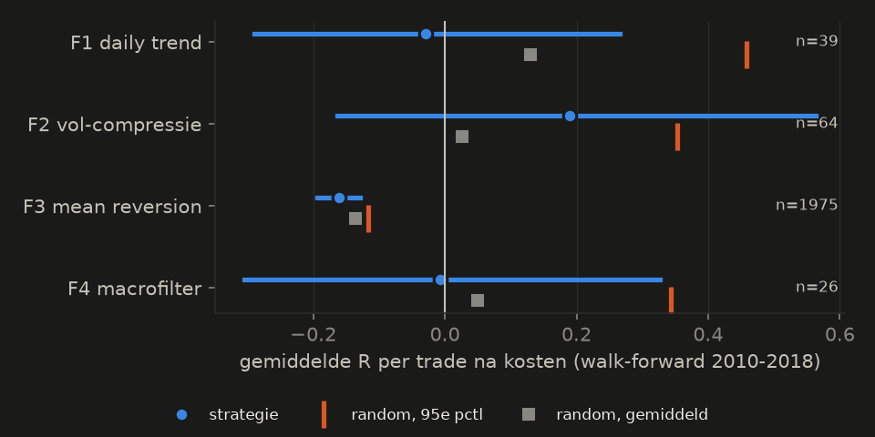
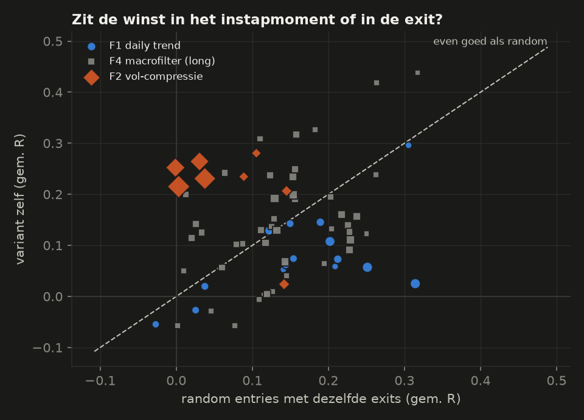
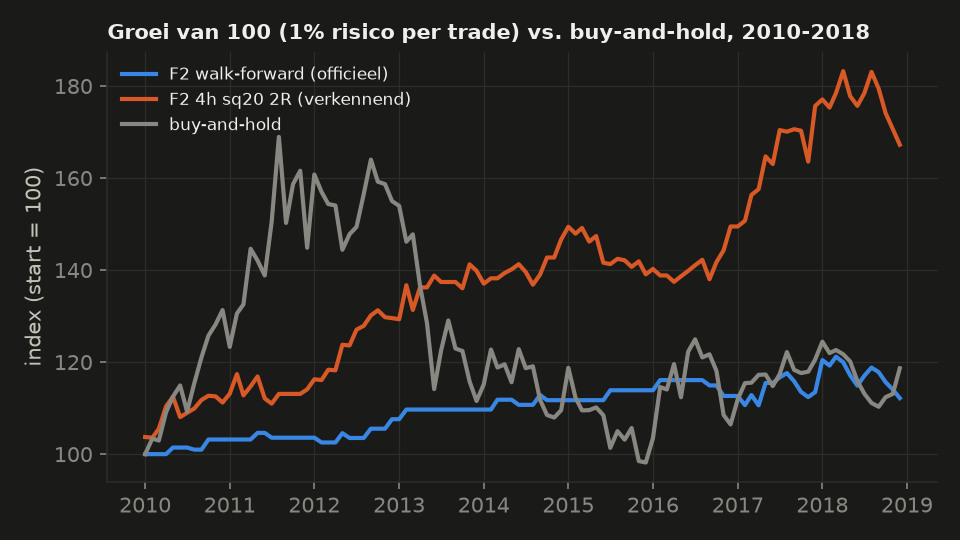
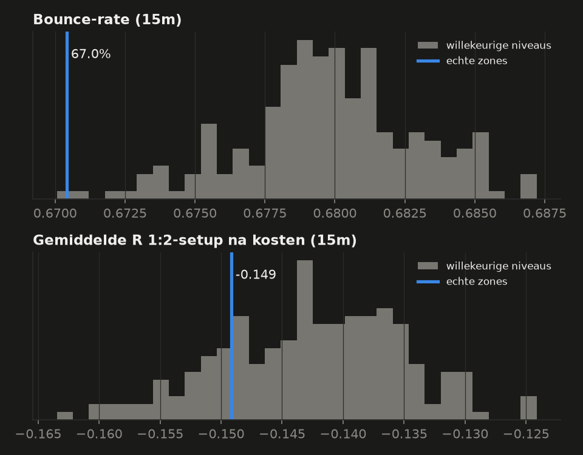

# Ronde 2: bestaat er een strategie op goud die na kosten werkt?

_Research-periode 2006–2018 (walk-forward test-jaren 2010–2018), XAUUSD spot (Dukascopy). Hold-out H2 (2019-01 t/m 2020-09) **niet geopend**. Opzet vooraf vastgelegd in [PLAN2.md](PLAN2.md). 756 trials in ronde 2, 1428 in totaal._

## Samenvatting in gewone taal

**Kort: ik heb geen strategie gevonden die aantoonbaar werkt.** Geen van de vier
strategie-families haalde de vooraf vastgelegde eisen. De zone-toets op 15m bevestigt
dat support/resistance-zones niets voorspellen. Eén aanwijzing (volatiliteitscompressie op
4h) is interessant, maar vond ik achteraf en is na correctie voor alle geprobeerde
varianten niet significant. Hold-out H2 is niet geopend en dus nog schoon.

**Wat niet werkt**
- **Mean reversion op 15m/1h in rustige markten (F3):** duidelijk verlieslatend, -0.161 R
  per trade na kosten, in elk jaar. Vóór kosten ongeveer nul: de spread eet het op.
- **S/R-zones op 15m (F5):** echte zones doen het niet beter dan willekeurige niveaus
  (bounce 67.0% tegen 68.0%). Hetzelfde als in ronde 1.
- **Daily trendvolgen (F1)** en **met een macrofilter (F4):** na walk-forward rond nul.
  Los bekeken zijn de meeste varianten licht positief, maar **willekeurige instappen met
  dezelfde trailing stop doen het even goed**. Het plusje zit in de exit, niet in het
  signaal. Het filter op reële rente of dollar helpt niet.

**Wat interessant maar onbewezen is**
- **Volatiliteitscompressie → breakout op 4h (F2):** alle vier de 4h-varianten liggen boven
  random met dezelfde exits, ongeveer +0,2 R per trade na kosten, nog positief bij 3×
  kosten, long en short allebei. Maar: de vooraf vastgelegde walk-forward koos ze bijna
  nooit (F2 werd rejected op te weinig trades). Het patroon zag ik pas achteraf, en na
  correctie voor 1428 geprobeerde varianten is het niet te onderscheiden van
  toeval.

**Wat onzeker is**
- Trage daily-strategieën leveren te weinig trades (9–90 per variant in 9 jaar) om iets
  zeker te zeggen.
- Alles is gemeten met vaste kosten (0,60 USD/oz per trade). Bij 15m/1h-strategieën is dat
  doorslaggevend.
- De periode 2010–2018 bevat een sterke stijging, een crash en zeven jaar zijwaarts/dalend:
  breder dan ronde 1, maar het blijft één markt.

## Overzicht per familie (walk-forward, out-of-sample)

| familie | status | trades | gem. R na kosten [95%-int.] | 2× kosten | 3× kosten | random zelfde exits: gem. / p95 | pctl t.o.v. random | Sharpe | max DD | DSR |
|---|---|---|---|---|---|---|---|---|---|---|
| F1 daily trend | **rejected** | 39 | -0.029 [-0.290; +0.265] | -0.038 | -0.047 | +0.130 / +0.459 | 22 | -0.07 | -8% | 0.00 |
| F2 vol-compressie | **rejected** | 64 | +0.190 [-0.164; +0.564] | +0.141 | +0.097 | +0.026 / +0.353 | 78 | 0.33 | -7% | 0.00 |
| F3 mean reversion | **rejected** | 1975 | -0.161 [-0.194; -0.129] | -0.260 | -0.336 | -0.136 / -0.116 | 2 | -3.03 | -96% | 0.00 |
| F4 macrofilter | **rejected** | 26 | -0.007 [-0.305; +0.326] | -0.016 | -0.026 | +0.049 / +0.344 | 40 | -0.01 | -4% | 0.00 |

Buy-and-hold over 2010–2018: 1.9% per jaar, max drawdown -42%, Sharpe 0.20, Calmar 0.05.

**Redenen per familie:** F1 daily trend: gem. R na kosten niet positief (-0.029); zonder beste jaar niet positief (-3.7R). F2 vol-compressie: te weinig trades (64 < 100). F3 mean reversion: gem. R na kosten niet positief (-0.161); zonder beste jaar niet positief (-310.3R). F4 macrofilter: te weinig trades (26 < 30); gem. R na kosten niet positief (-0.007); zonder beste jaar niet positief (-2.8R).

## Begrippen

- **R**: winst of verlies in eenheden van het risico. Bij een stop verlies je 1 R. Met
  kosten is een stop precies −1 R en is een winst iets kleiner.
- **Walk-forward**: elk jaar kiezen we de beste variant op de vier jaar ervóór (train)
  en meten we die op het jaar erna (test). Alleen de test-jaren tellen. Zo kan de keuze
  nooit op het testresultaat leunen.
- **Random entries met dezelfde exits**: we vervangen het instapmoment door een
  willekeurige candle in hetzelfde jaar, met evenveel trades en dezelfde long/short-
  verhouding, en houden stop, target en trailing exact gelijk. Wint de strategie niet van
  vrijwel al die random versies (95e percentiel), dan zit er geen waarde in het
  instapmoment. Dit vangt ook de "long-bias" van goud.
- **Win rate en break-even win rate**: hoeveel procent van de trades winst gaf, en hoeveel
  dat bij deze verhouding tussen gemiddelde winst en verlies minimaal moet zijn. Alleen
  ter informatie: een hoge win rate zegt niets als de verliezen groter zijn.
- **Sharpe** (per jaar, uit maandrendementen) en **Calmar** (jaarrendement / grootste
  daling): rendement gecorrigeerd voor risico, vergelijkbaar met buy-and-hold.
- **DSR** (deflated Sharpe): hoe zeker is het dat dit beter is dan de beste van alle
  geprobeerde varianten bij puur toeval? Lat: 0,95.

## F1 daily trend

**Methode.** Op het daily slot: koop als het slot boven het hoogste punt van de vorige
50 of 100 dagen uitkomt (Donchian), of als het rendement over 3, 6 of 12 maanden positief
is (momentum). Short gespiegeld. Exit alleen via een trailing stop op 3, 4 of 5 × ATR,
die meeschuift met het hoogste slot. 15 varianten, walk-forward-selectie per jaar.

|  | waarde |
|---|---|
| trades (long / short) | 39 (21 / 18) |
| gem. R na kosten 1× / 2× / 3× / bruto | -0.029 / -0.038 / -0.047 / -0.019 |
| 95%-interval (1×) | -0.029 [-0.290; +0.265] |
| long / short (1×) | +0.052 / -0.123 |
| win rate (alleen ter info) / break-even | 36% / 38% |
| verliesjaren | 5 van 9 |
| random met dezelfde exits: gem. / 95e pctl / positie | +0.130 / +0.459 / 22e pctl |
| Sharpe / Calmar / max DD | -0.07 / -0.02 / -8% |
| DSR (streng / mild) | 0.00 / 0.00 |
| status | **rejected** – gem. R na kosten niet positief (-0.029); zonder beste jaar niet positief (-3.7R) |

**Per test-jaar (totaal R, trades):** 2010: +0.7 (2), 2011: +2.0 (2), 2012: +0.3 (1), 2013: +2.6 (3), 2014: -0.6 (5), 2015: -1.3 (3), 2016: -1.8 (7), 2017: -2.4 (10), 2018: -0.7 (6)

**Gekozen variant per jaar:** 2010: `entry=donchian100|trail_atr=5`, 2011: `entry=donchian100|trail_atr=5`, 2012: `entry=donchian100|trail_atr=4`, 2013: `entry=donchian100|trail_atr=3`, 2014: `entry=tsmom12|trail_atr=5`, 2015: `entry=donchian100|trail_atr=3`, 2016: `entry=tsmom12|trail_atr=5`, 2017: `entry=tsmom6|trail_atr=4`, 2018: `entry=tsmom6|trail_atr=4`

**Resultaat.** Na selectie: -0.029 R per trade -0.029 [-0.290; +0.265] over 39 trades. Dat is
statistisch niet te onderscheiden van nul. De selectie koos bijna elk jaar een andere
variant: wat de afgelopen vier jaar het beste werkte, voorspelde het volgende jaar niet.

Los bekeken zijn 13 van de 15 varianten positief over 2010–2018, maar **elke variant doet
het ongeveer even goed als random entries met dezelfde trailing stop** (4e tot 55e
percentiel, mediaan 36). Random entries met deze exits halen gemiddeld +0.130 R. Het
kleine plusje komt dus uit de exit: verliezers worden afgekapt, winnaars lopen door.
Het instapsignaal (breakout, momentum) voegt niets toe. Long gemiddeld +0,15 R,
short +0,01 R.

**Onzekerheid.** Groot: maar ~40 trades na selectie, het interval loopt van −0,29 tot
+0,27 R.

## F2 vol-compressie

**Methode.** Eerst een rustige periode: de breedte van de Bollinger-banden is de laagste
10% of 20% van het afgelopen jaar. Daarna koop (verkoop) bij een slot boven (onder) het
hoogste (laagste) punt van de vorige 20 candles. Stop op 2 × ATR, exit op 2R of via een
trailing stop van 3 × ATR. Op 4h- en daily-candles: 8 varianten.

|  | waarde |
|---|---|
| trades (long / short) | 64 (33 / 31) |
| gem. R na kosten 1× / 2× / 3× / bruto | +0.190 / +0.141 / +0.097 / +0.244 |
| 95%-interval (1×) | +0.190 [-0.164; +0.564] |
| long / short (1×) | +0.218 / +0.160 |
| win rate (alleen ter info) / break-even | 38% / 30% |
| verliesjaren | 2 van 9 |
| random met dezelfde exits: gem. / 95e pctl / positie | +0.026 / +0.353 / 78e pctl |
| Sharpe / Calmar / max DD | 0.33 / 0.17 / -7% |
| DSR (streng / mild) | 0.00 / 0.00 |
| status | **rejected** – te weinig trades (64 < 100) |

**Per test-jaar (totaal R, trades):** 2010: +3.2 (3), 2011: +0.4 (2), 2012: +3.9 (5), 2013: +1.9 (1), 2014: +1.9 (4), 2015: +1.9 (1), 2016: -1.1 (4), 2017: +6.0 (21), 2018: -6.0 (23)

**Gekozen variant per jaar:** 2010: `timeframe=1d|squeeze_pct=10|exit=trail_3atr`, 2011: `timeframe=1d|squeeze_pct=10|exit=trail_3atr`, 2012: `timeframe=1d|squeeze_pct=10|exit=target_2R`, 2013: `timeframe=1d|squeeze_pct=10|exit=target_2R`, 2014: `timeframe=1d|squeeze_pct=10|exit=target_2R`, 2015: `timeframe=1d|squeeze_pct=10|exit=target_2R`, 2016: `timeframe=1d|squeeze_pct=10|exit=target_2R`, 2017: `timeframe=4h|squeeze_pct=10|exit=trail_3atr`, 2018: `timeframe=4h|squeeze_pct=10|exit=trail_3atr`

**Resultaat.** Na selectie: +0.190 R per trade +0.190 [-0.164; +0.564] over 64 trades. Dat is
**rejected omdat er minder dan 100 trades zijn.** De walk-forward koos in 7 van de 9
jaren een daily-variant (hoogste gemiddelde in het train-venster, maar weinig trades) en
pas in 2017–2018 de 4h-variant. Ten opzichte van random met dezelfde exits staat hij op het
78e percentiel: niet overtuigend.

## F3 mean reversion

**Methode.** Alleen in een rustig regime (ADX < 20, of ATR-percentiel < 33): koop een slot
onder de onderste Bollinger-band (2 of 2,5σ), verkoop boven de bovenste. Target: het
20-candle-gemiddelde. Stop 1,5 of 2,5 × ATR, na 40 candles eruit. Op 15m en 1h:
16 varianten.

|  | waarde |
|---|---|
| trades (long / short) | 1975 (972 / 1003) |
| gem. R na kosten 1× / 2× / 3× / bruto | -0.161 / -0.260 / -0.336 / -0.025 |
| 95%-interval (1×) | -0.161 [-0.194; -0.129] |
| long / short (1×) | -0.174 / -0.149 |
| win rate (alleen ter info) / break-even | 54% / 65% |
| verliesjaren | 9 van 9 |
| random met dezelfde exits: gem. / 95e pctl / positie | -0.136 / -0.116 / 2e pctl |
| Sharpe / Calmar / max DD | -3.03 / -0.31 / -96% |
| DSR (streng / mild) | 0.00 / 0.00 |
| status | **rejected** – gem. R na kosten niet positief (-0.161); zonder beste jaar niet positief (-310.3R) |

**Per test-jaar (totaal R, trades):** 2010: -63.9 (574), 2011: -8.2 (88), 2012: -13.3 (182), 2013: -11.1 (59), 2014: -40.1 (163), 2015: -23.6 (110), 2016: -39.8 (273), 2017: -64.9 (271), 2018: -53.5 (255)

**Gekozen variant per jaar:** 2010: `timeframe=15m|regime=adx|band_z=2.0|stop_atr=2.5`, 2011: `timeframe=1h|regime=atr_pct|band_z=2.0|stop_atr=2.5`, 2012: `timeframe=1h|regime=atr_pct|band_z=2.0|stop_atr=2.5`, 2013: `timeframe=1h|regime=atr_pct|band_z=2.0|stop_atr=2.5`, 2014: `timeframe=1h|regime=atr_pct|band_z=2.0|stop_atr=2.5`, 2015: `timeframe=1h|regime=adx|band_z=2.0|stop_atr=1.5`, 2016: `timeframe=15m|regime=adx|band_z=2.5|stop_atr=2.5`, 2017: `timeframe=15m|regime=adx|band_z=2.5|stop_atr=2.5`, 2018: `timeframe=15m|regime=adx|band_z=2.5|stop_atr=2.5`

**Resultaat.** Duidelijk negatief: -0.161 R -0.161 [-0.194; -0.129] over 1975 trades, in elk jaar
verlies. Vóór kosten is het bijna nul (−0,03 R); de kosten (0,60 USD per ounce) zijn bij
de kleine stops op 15m/1h een groot deel van het risico. Geen enkele van de 16 varianten is
positief, en de strategie is zelfs **slechter dan random** met dezelfde exits (2e
percentiel). De win rate is 54%, maar de break-even win rate bij deze verhouding
winst/verlies is 65%. Dit is het klassieke beeld van "vaak een beetje winnen, soms veel
verliezen".

**Onzekerheid.** Klein: het interval ligt ruim onder nul.

## F4 macrofilter

**Methode.** De F1-regels, maar alleen long, en alleen als de reële rente (10-jaars TIPS)
of de dollarindex de afgelopen 20 handelsdagen daalde. Om lookahead te voorkomen gebruiken
we een waarde pas 3 (rente) of 10 (dollar) dagen na de datum, zodat hij zeker gepubliceerd
was. Plus de variant zonder filter als referentie: 45 varianten.

|  | waarde |
|---|---|
| trades (long / short) | 26 (26 / 0) |
| gem. R na kosten 1× / 2× / 3× / bruto | -0.007 / -0.016 / -0.026 / +0.003 |
| 95%-interval (1×) | -0.007 [-0.305; +0.326] |
| long / short (1×) | -0.007 / – |
| win rate (alleen ter info) / break-even | 38% / 39% |
| verliesjaren | 4 van 9 |
| random met dezelfde exits: gem. / 95e pctl / positie | +0.049 / +0.344 / 40e pctl |
| Sharpe / Calmar / max DD | -0.01 / -0.01 / -4% |
| DSR (streng / mild) | 0.00 / 0.00 |
| status | **rejected** – te weinig trades (26 < 30); gem. R na kosten niet positief (-0.007); zonder beste jaar niet positief (-2.8R) |

**Per test-jaar (totaal R, trades):** 2010: +0.4 (3), 2011: +2.6 (4), 2012: +0.7 (1), 2013: -0.7 (1), 2014: -0.6 (1), 2015: -1.7 (2), 2016: +0.2 (2), 2017: +1.2 (6), 2018: -2.2 (6)

**Gekozen variant per jaar:** 2010: `entry=donchian50|trail_atr=4|filter=reele_rente`, 2011: `entry=tsmom3|trail_atr=5|filter=reele_rente`, 2012: `entry=donchian100|trail_atr=3|filter=dollar`, 2013: `entry=donchian50|trail_atr=3|filter=dollar`, 2014: `entry=tsmom12|trail_atr=4|filter=reele_rente`, 2015: `entry=tsmom12|trail_atr=4|filter=reele_rente`, 2016: `entry=tsmom6|trail_atr=4|filter=dollar`, 2017: `entry=tsmom6|trail_atr=4|filter=geen`, 2018: `entry=tsmom6|trail_atr=3|filter=geen`

**Resultaat.** Na selectie: -0.007 R -0.007 [-0.305; +0.326] over maar 26 trades: rejected. Los
bekeken helpt het filter niet: de reële-rente-filter is in 5 van de 15 gevallen beter dan
geen filter, de dollar-filter in 8 van de 15, en gemiddeld zijn ze allebei iets slechter.
De varianten liggen rond het niveau van random longs met dezelfde trailing stop (mediaan
53e percentiel, geen enkele boven het 95e). De economische reden (goud als alternatief voor
rente en dollar) is plausibel, maar een simpel 20-dagenfilter haalt er niets bruikbaars uit.

**Onzekerheid.** Groot (weinig trades per variant: 9–54).

## Verkenning: F2 op 4h (achteraf, niet gekozen in de walk-forward)

Dit stuk is **achteraf** toegevoegd (gelogd in PLAN2 §10) en telt niet als bewijs. Het
gaat over de 4h-varianten van F2, zonder selectie, over alle test-jaren 2010–2018.

**Wat opvalt.** Alle vier de 4h-varianten liggen boven het 95e percentiel van random
entries met exact dezelfde exits. Bij random is het ≈ 0 R, bij de varianten +0,22 tot
+0,26 R. Het ruimste voorbeeld, *squeeze 20%, target 2R*: +0.215 R +0.215 [+0.044; +0.399] over 251
trades, nog +0.109 R bij 3× kosten, long +0.178 en short +0.251, 2
verliesjaren van 9, zonder de 5 beste trades nog +0.180 R. Sharpe 0.80 en Calmar
0.67 tegen 0.20 en 0.05 voor buy-and-hold, max drawdown -9%
tegen -42%. Win rate 43% bij een break-even van 35% (alleen ter info).

**Waarom dit nog geen bevinding is.**
1. Het is gevonden ná het zien van de resultaten. De vooraf vastgelegde procedure
   (walk-forward) koos deze varianten maar in 2 van de 9 jaren.
2. Na correctie voor alle 1428 geprobeerde varianten is de DSR 0.00 (mild:
   0.00). Formeel is het dus niet te onderscheiden van de beste van veel
   toevalsvarianten.
3. Het is één familie op één timeframe. Een plausibele verklaring (volatiliteit clustert,
   na compressie komt beweging) maakt het geloofwaardiger, maar bewijst niets.

De trailing-varianten leunen sterker op een paar grote trades en op shorts in de
berenmarkt van 2013–2016. De 2R-varianten minder.

| variant | trades | gem. R [95%-int.] | 3× kosten | long / short | zonder top-5 | random zelfde exits (pctl) | Sharpe | DSR / mild |
|---|---|---|---|---|---|---|---|---|
| timeframe=4h|squeeze_pct=10|exit=target_2R | 177 | +0.252 [+0.050; +0.477] | +0.138 | +0.224 / +0.280 | +0.204 | 99 | 0.77 | 0.00 / 0.00 |
| timeframe=4h|squeeze_pct=10|exit=trail_3atr | 171 | +0.264 [+0.024; +0.557] | +0.148 | +0.102 / +0.445 | +0.065 | 96 | 0.64 | 0.00 / 0.00 |
| timeframe=4h|squeeze_pct=20|exit=target_2R | 251 | +0.215 [+0.044; +0.399] | +0.109 | +0.178 / +0.251 | +0.180 | 99 | 0.80 | 0.00 / 0.00 |
| timeframe=4h|squeeze_pct=20|exit=trail_3atr | 236 | +0.231 [+0.028; +0.472] | +0.122 | +0.083 / +0.391 | +0.085 | 96 | 0.69 | 0.00 / 0.00 |

## F5 – Zone-toets op 15m

**Methode.** Precies de toets van ronde 1 (vraag 1): elke keer dat een candle een
bekende zone raakt, meten we of de koers terugveert en wat een vaste 1:2-trade na kosten
oplevert, en we vergelijken dat met 200 keer dezelfde zones verschoven naar willekeurige
niveaus. Nu op **15m-candles**, over 12 jaar (2007–2018), met zones van het laatst
gesloten uur.

**Resultaat.** 66441 tests. De echte zones hadden een bounce-rate van 67.0% en de
willekeurige niveaus 68.0%: de echte zones scoren **slechter** (percentiel
0). Gemiddelde R -0.149 tegenover -0.143 (percentiel 19). Per jaar
waren de echte zones maar in 1 van de 12 jaren beter op bounce en in 3 van de 12
jaren op R. Vóór kosten is de R ongeveer nul (+0.014); de kosten maken hem negatief.

**Onzekerheid.** Klein: ~66.000 tests over twaalf jaar, smalle intervallen. Een
zone-effect van betekenis is uitgesloten.

**Beslissing (vooraf vastgelegd):** geen verschil: geen 15m-zonestrategie bouwen. Dit bevestigt ronde 1, nu op een andere
timeframe en over een veel langere periode met stijgende, dalende en zijwaartse jaren.

| meetwaarde | echte zones [95%-int.] | willekeurige niveaus | pctl | jaren beter |
|---|---|---|---|---|
| bounce-rate | 67.0% [66.5; 67.7] | 68.0% | 0 | 1 van de 12 |
| gem. R 1:2-setup na kosten | -0.149 [-0.162; -0.136] | -0.143 | 19 | 3 van de 12 |

Aantal tests: 66441. **Beslissing: geen verschil: geen 15m-zonestrategie bouwen.**

## Correctie voor het aantal varianten

In totaal zijn **1428 varianten** geprobeerd: 671 in ronde 1, 1 opening van
de verbrande hold-out (H1) en 756 in ronde 2 (elke variant in elk train-venster
telt als één). Hoe meer je probeert, hoe beter de beste er bij toeval uitziet. De
deflated Sharpe ratio schat hoe goed die beste-door-toeval zou zijn en vraagt of de
strategie daar duidelijk boven zit. Met zoveel varianten en de grote spreiding tussen
trials (veel trials hebben maar 8–50 trades) ligt die lat hoog: per trade een Sharpe
van ~0,9. Geen enkele familie of variant komt daar in de buurt (DSR 0,00), ook niet in
de mildere variant die de meetruis eruit haalt.

In gewone taal: zelfs het beste resultaat van ronde 2 is niet beter dan wat je mag
verwachten als je ~1.400 keer iets willekeurigs probeert. Dat betekent niet dat het
zeker toeval is, maar wel dat deze data het niet kunnen bewijzen.

**Verbrande hold-out.** De laatste 12 maanden (H1) zijn in ronde 1 één keer geopend
door ema_pullback. Ze tellen als één extra trial en worden in ronde 2 niet gebruikt. Het
blok 2020-10 t/m 2025-09 (K) is in ronde 1 uitgebreid bekeken en is daarom ook niet
gebruikt. De nieuwe hold-out H2 (2019-01 t/m 2020-09) is **niet geopend**, omdat geen
enkele strategie candidate werd.

## Wat ik gecontroleerd heb

- **Lookahead**: voor elke familie een test die alle data na een moment verandert. De
  signalen tot dat moment blijven gelijk (`tests/test_round2.py`). Donchian kijkt alleen
  naar vorige candles. Macro-data pas na een vaste publicatievertraging. Een 15m-candle
  gebruikt alleen zones van het laatst gesloten uur (eigen test).
- **Fill-volgorde**: entry op de open van de volgende candle; stop vóór target in
  dezelfde candle; gat voorbij de stop = exit op de open; trailing stop pas actief na het
  slot; tijdstop op het slot (tests).
- **Kosten**: R bij 1×, 2× en 3× kosten herberekend uit winst en risico per ounce (test
  dat een stop precies −1 R is bij elke kostenfactor).
- **Dubbeltellingen**: max. 1 open positie per variant (test); voor de F2-4h-varianten
  nagerekend: 0 overlappende trades.
- **Long-bias**: long en short apart gerapporteerd; elke vergelijking met random gebruikt
  dezelfde long/short-verhouding per jaar.
- **Sessie-wijziging 2013**: de F2-4h-varianten zijn vóór én na 2013 positief
  (squeeze 20/2R: +0,27 en +0,18 R).
- **Uitschieters**: F2-4h zonder de 5 beste trades nog steeds positief (2R-varianten +0,18
  tot +0,20 R; trailing-varianten maar +0,07 tot +0,09 R).

## Conclusie

1. **Er is geen regelgebaseerde strategie gevonden met een aangetoonde positieve
   verwachting na kosten.** Dat is de eerlijke uitkomst van 1428 geprobeerde
   varianten over twee rondes.
2. **Support/resistance-zones** voorspellen op goud niets, op 1h (ronde 1) noch op 15m
   (ronde 2, 2007–2018).
3. **Kortetermijn-mean-reversion** verliest structureel door de kosten.
4. **Trendvolgen** werkt niet door het instapsignaal. Een trailing stop maakt de
   R-verdeling scheef (kleine verliezen, af en toe een grote winst), en dat doet hij ook bij
   willekeurige instappen.
5. **Volatiliteitscompressie op 4h** is de enige aanwijzing die een vervolg verdient. Hij is
   alleen nog geen bevinding: gevonden na het kijken, niet gekozen door de vooraf
   vastgelegde procedure, en niet significant na correctie.
6. Buy-and-hold had in 2010–2018 een slechte risico/rendement-verhouding (Sharpe
   0.20, max daling -42%). In ronde 1 (2021–2025) was buy-and-hold juist veel
   beter dan alles. Wat werkt, hangt sterk af van de periode.

**Zeker niet doen:** een van deze strategieën met echt geld handelen. Ook niet de
F2-variant: die heeft eerst een onafhankelijke bevestiging nodig.

## Voorstel (vraagt jouw akkoord)

Er gaat niets naar paper trading en de live workflow verandert niet. Mijn voorstel, als
je dat wilt:

1. **Eén bevestigingstoets op hold-out H2** voor precies één, nu vast te leggen variant:
   F2, 4h, squeeze 20%, stop 2 × ATR, target 2R (de variant met de meeste trades en de
   minste afhankelijkheid van uitschieters). H2 is nog nooit geopend. Dit wijkt af van
   PLAN2 (H2 alleen voor candidates), daarom vraag ik het eerst. Uitkomst telt alleen als
   aanwijzing: ook bij een positieve H2 blijft de DSR-correctie hem tegenhouden voor
   *validated*.
2. Ofwel: geen hold-out openen en F2-4h (vast) **alleen forward op paper** volgen, met een
   vooraf vastgelegde evaluatie na bijvoorbeeld 100 trades (~3–4 jaar op 4h).

Beide vragen jouw akkoord. Zonder akkoord doe ik niets.

