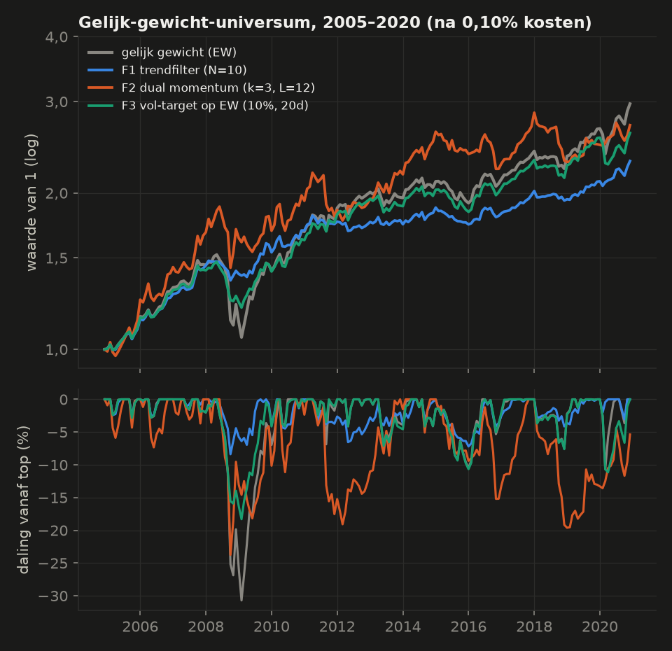
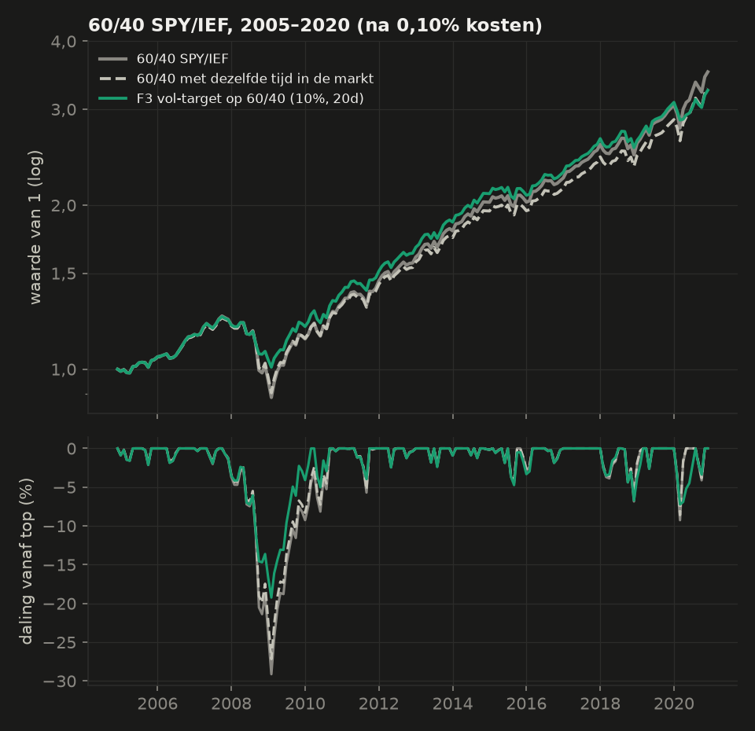
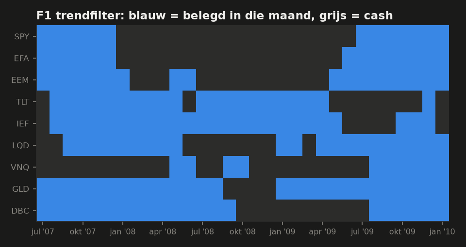
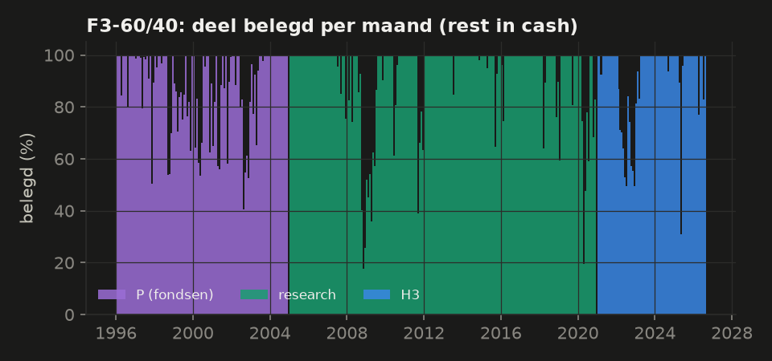
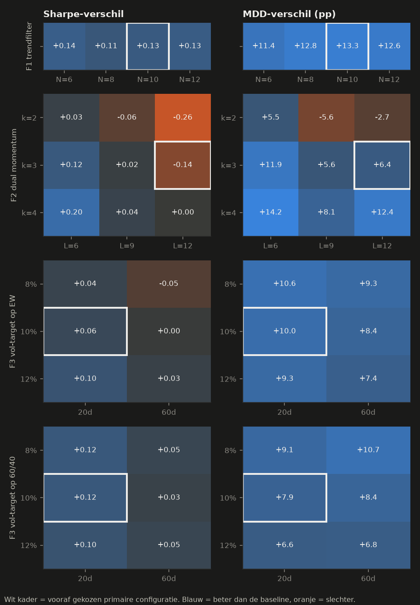
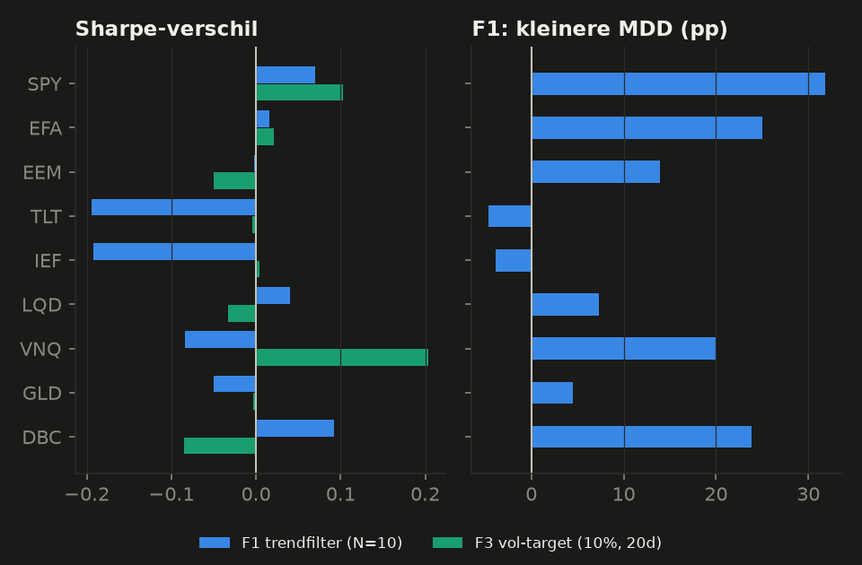
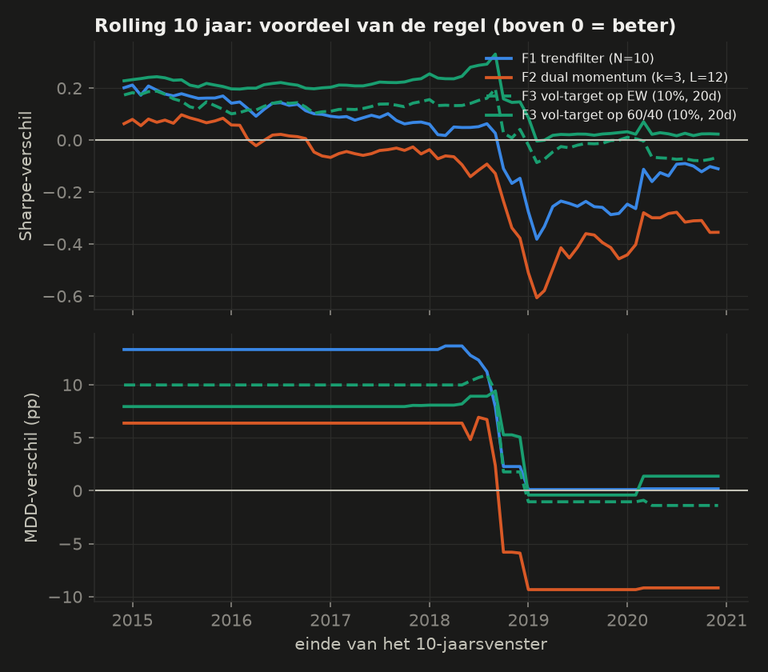
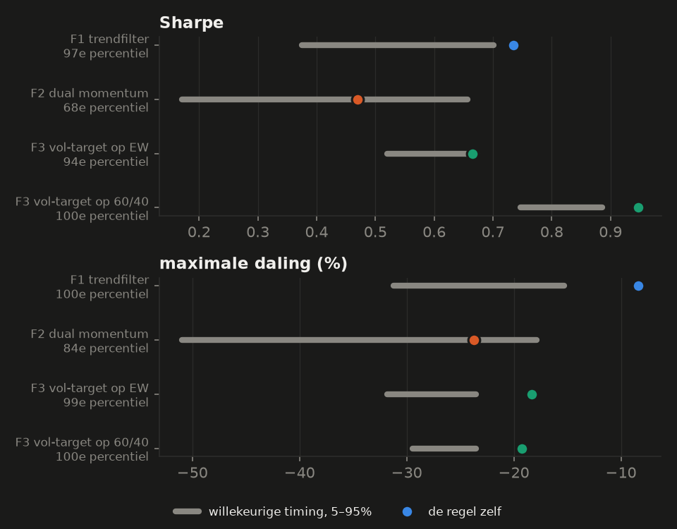

# Ronde 3: lage-frequentie regels op een gespreid ETF-universum

_Research 2005-01 – 2020-12 (192 maanden), 9 US-ETF's, signaal op het maandslot en uitvoering op het slot van de eerste handelsdag daarna, kosten 0,10% van het verhandelde bedrag. Opzet vooraf vastgelegd in [PLAN3.md](PLAN3.md). 25 trials. Hold-out H3 (2021-01 – 2026-09) 1× geopend, pre-sample P (1996–2004) 1× geopend, beide alleen voor de enige candidate. Alleen onderzoek: geen paper trading, geen Telegram, geen echt geld._

## Oordeel in gewone taal

**Kort: geen van de regels is aantoonbaar beter dan gewoon gespreid beleggen. Eén regel geeft een zwakke, onbevestigde aanwijzing.**

- **Volgens de vooraf vastgelegde regels (PLAN3 §9):** (c) *beter* voor één regel, volatility targeting op 60/40 (F3-60/40), en (a) *geen verbetering* voor de andere drie. **Niets is validated.**
- **Hoe zeker: laag.** F3-60/40 verbeterde in research de Sharpe met +0,12 en verkleinde de maximale daling van −29,1% naar −19,2%, bij een rendement dat 0,5 procentpunt per jaar lager lag. In de praktijk is dat dus vooral (b): bijna hetzelfde rendement met een kleinere daling.
  - Maar:
    - in H3 (2021–2026) was het voordeel klein: +0,03 Sharpe;
    - in de pre-sample 1996–2004 was het er niet: −0,10 Sharpe, en de daling was 2,4 procentpunt groter dan bij een vaste mix met evenveel cash;
    - na correctie voor 25 geprobeerde regels is het verschil niet significant (p = 0,57 voor Sharpe, 0,10 voor de daling);
    - voor een belegger in euro's verdwijnt het voordeel grotendeels (Sharpe −0,03 tot +0,04).

**Wat werkt (een beetje, onzeker)**
- **Volatility targeting op 60/40:** minder beleggen als de markt onrustig is. Dat hielp in 2008 duidelijk (oktober 2008: −4,0% tegen −10,3% voor 60/40) en in 2022. Het effect komt vrijwel helemaal uit het aandelendeel.
  - Keerzijde: in 2020 schaalde hij pas ná de crash terug (op het slot van maart maar 19% belegd, dus in april vooral cash) en miste een deel van het herstel: 2020 +6,6% tegen +16,6%.

**Wat niet werkt**
- **Dual momentum (F2):** slechter dan gelijk gewicht (Sharpe −0,14), met veel meer handel (444% van de portefeuille per jaar).
- **Volatility targeting op gelijk gewicht (F3-EW):** een kleinere daling, maar te onzeker (Sharpe +0,06 [−0,19; +0,22]).

**Wat opvallend maar niet stabiel is**
- **Trendfilter (F1, N = 10):** de grootste daling zakte van −30,7% (gelijk gewicht) naar −8,4%. Dat is ook 13,3 procentpunt beter dan een vaste mix met dezelfde tijd in de markt, en het overleeft zelfs de correctie voor 25 trials (p = 0,038).
  - **Maar dat komt vrijwel helemaal uit één crisis (2008).** In 2010–2014 en 2015–2020 was het voordeel er niet, en het rendement lag 1,7 procentpunt per jaar lager.
  - Volgens de vooraf vastgelegde regel (stabiel in ≥ 2 van 3 subperiodes) is F1 daarom **rejected**.
  - Eerlijk gezegd: een trendfilter is in de eerste plaats een verzekering tegen lange crashes, en die komen zelden voor. Met 16 jaar data, waarin maar één echte crash zat, is dat niet te bewijzen en ook niet uit te sluiten.

**Wat onzeker blijft**
- Met 16 jaar maanddata kun je alleen grote verschillen aantonen. Een Sharpe-verbetering kleiner dan ongeveer 0,25 (F3-60/40) tot 0,64 (F2) blijft onzichtbaar. In de literatuur gaat het om +0,1 tot +0,3.
- De resultaten hangen sterk af van twee crises (2008 en 2020). Een volgende crisis kan heel anders verlopen, bijvoorbeeld als aandelen en obligaties samen dalen, zoals in 2022.

## Begrippen, uitgelegd met de data

- **Maximale daling (MDD):** het grootste verlies vanaf een top, gemeten op maandsloten.
  - *Voorbeeld:* gelijk gewicht over de ETF's stond eind mei 2008 op een top, zakte tot eind feb 2009 30,7%, en was pas in apr 2010 weer terug.
  - Gemeten per dag was de daling nog groter: −34,9%.
- **Sharpe:** rendement *boven cash* (T-bills) per eenheid beweeglijkheid, per jaar.
  - *Voorbeeld:* 60/40 had 8,2% per jaar, met een beweeglijkheid (volatiliteit) van 8,4%. Na aftrek van het cashrendement levert dat een Sharpe van 0,83 op.
  - Een Sharpe-verschil van +0,10 betekent: bij dezelfde volatiliteit van bijvoorbeeld 8% per jaar levert de regel 0,8 procentpunt per jaar meer op (0,10 × 8%).
- **Tijd in de markt:** het gemiddelde deel van het geld dat belegd is.
  - *Voorbeeld:* de trendregel F1 was gemiddeld voor 69% belegd; de rest stond in cash.
- **Mix met dezelfde tijd in de markt:** de eerlijke vergelijking voor een kleinere daling.
  - Wie altijd 69% in gelijk gewicht en de rest in cash houdt, heeft zonder enige regel al een daling van −21,7% in plaats van −30,7%.
  - F1 (−8,4%) is dus 13,3 procentpunt beter dan zo'n vaste mix. Alleen dát deel komt door de timing.
- **Trendfilter, concreet (oktober 2008):** op het slot van 30 september 2008 lagen alleen TLT, IEF, VNQ boven hun 10-maandsgemiddelde. Er was 33% belegd (1/9 per asset) en 67% stond in cash.
  - SPY lag 11,8% en EEM 23,3% onder het gemiddelde, dus die waren uitgestapt.
  - In oktober zakten SPY −16,5%, EFA −20,8% en EEM −25,6%. F1 verloor die maand −4,1%, gelijk gewicht −15,7%.
  - Pech: VNQ lag nét 0,6% boven zijn gemiddelde, deed dus mee, en zakte −31,7%.
  - Over heel 2008: F1 −1,1%, gelijk gewicht −16,3%. Maar in 2009 stapte F1 pas laat weer in (+12,3% tegen +19,3%).
  - **2022 voor de trendregel kan ik niet laten zien:** 2022 ligt in H3, en H3 mag volgens de afspraak alleen open voor candidates. F1 is rejected, dus H3 blijft voor F1 dicht.
- **Volatility targeting, concreet:** eind september 2008 was de beweeglijkheid van 60/40 over de laatste 20 handelsdagen (op jaarbasis) ongeveer 25%.
  - Doel 10% ÷ 25% = 40% belegd: 24% SPY, 16% IEF, de rest cash. Eind oktober was dat 18%.
  - In 2022 (H3, geopend) zakte het belegde deel van 87% (slot januari) tot 49% (slot juni). Over 2022: −13,7% tegen −16,6% voor 60/40.
- **Bootstrap-interval:** hoe zeker een verschil is. We trekken 2000 keer een nieuwe '16 jaar' uit de echte maanden, in aaneengesloten blokken van gemiddeld 12 maanden (crises blijven heel), en kijken hoe het verschil dan schommelt.
  - *Voorbeeld:* F3-60/40, Sharpe-verschil +0,12 [−0,06; +0,26]. Het interval bevat 0, dus het kan ook toeval zijn. In 83% van de trekkingen was de regel beter.
- **Reality Check (correctie voor 25 trials):** als je 25 regels probeert, is er bij toeval altijd wel één die goed lijkt.
  - De toets schat hoe groot het grootste toevalsverschil over 25 regels is. Bij de daling is dat (95e percentiel) 11,8 procentpunt, bij Sharpe 0,47.
  - Alleen wat daar duidelijk bovenuit komt, telt als bewezen.

## Opzet

- **Universum (9 ETF's):** SPY (VS-aandelen), EFA (ontwikkelde markten), EEM (opkomende markten), TLT (VS-staats 20+ jaar), IEF (VS-staats 7–10 jaar), LQD (bedrijfsobligaties), VNQ (vastgoed), GLD (goud) en DBC (grondstoffen).
  - Een ETF doet mee vanaf 13 maandsloten. Zo groeit het universum van 6 (2005) naar 9 (vanaf maart 2007).
- **Data:** yfinance Adj Close (inclusief dividend), cash = 3-maands T-bill (FRED TB3MS). Belasting is niet meegenomen.
  - Geen ontbrekende handelsdagen.
  - De dividendcorrectie klopt tot op 0,07 procentpunt per jaar met slotkoers + zelf herbeleggen.
- **Uitvoering:** signaal op het slot van de laatste handelsdag van de maand, uitvoering op het slot van de eerste handelsdag erna. Het rendement van die dag hoort nog bij de oude gewichten.
  - Tussen twee uitvoeringen drijven de gewichten mee.
  - Kosten = 0,10% × verhandeld bedrag; gevoeligheid 0% en 0,30%.
- **Primaire configuraties** (vooraf gekozen, niet de beste cel): F1 N = 10; F2 k = 3, L = 12; F3 doel 10%, 20 dagen, op gelijk gewicht én op 60/40.

| Blok | Periode | Keer geopend |
|---|---|---|
| Research | 2005-01 – 2020-12 | – |
| H3 | 2021-01 – 2026-09 | 1 (alleen F3-60/40) |
| P (fondsen als proxy) | 1996-01 – 2004-12 | 1 (alleen F3-60/40) |

## Overzicht: de vier primaire configuraties (research 2005–2020)

Sharpe-verschil = t.o.v. de volle baseline. MDD-verschil = t.o.v. dezelfde baseline met dezelfde tijd in de markt, in procentpunt (positief = de regel daalt minder). Tussen haken: 95%-bootstrap-interval.

| Regel | Baseline | Sharpe-verschil | MDD-verschil (pp) | Status |
|---|---|---|---|---|
| F1 | EW | +0,13 [−0,26; +0,44] | +13,3 [−1,7; +20,4] | **rejected** |
| F2 | EW | −0,14 [−0,60; +0,28] | +6,4 [−19,1; +13,2] | **rejected** |
| F3-EW | EW | +0,06 [−0,19; +0,22] | +10,0 [−3,2; +14,7] | **rejected** |
| F3-60/40 | 60/40 | +0,12 [−0,06; +0,26] | +7,9 [−0,6; +11,6] | **candidate** (+H3, −P) |

|  | CAGR | Vol | Sharpe | MDD | Slechtste jaar | Belegd | Omloop/jaar |
|---|---|---|---|---|---|---|---|
| Gelijk gewicht (EW) | 7,0% | 10,1% | 0,61 | −30,7% | −16,3% | 100% | 46% |
| 60/40 | 8,2% | 8,4% | 0,83 | −29,1% | −17,7% | 100% | 31% |
| F1 | 5,4% | 5,7% | 0,74 | −8,4% | −4,1% | 69% | 193% |
| F2 | 6,4% | 12,3% | 0,47 | −23,7% | −14,1% | 98% | 444% |
| F3-EW | 6,2% | 7,7% | 0,67 | −18,3% | −10,9% | 92% | 114% |
| F3-60/40 | 7,6% | 6,7% | 0,95 | −19,2% | −12,5% | 93% | 99% |

Tussen haken: de volle baseline.

|  | 2008 | 2020 | Sortino | Calmar | MDD per dag | Transacties/jaar |
|---|---|---|---|---|---|---|
| F1 | −1,1% (−16,3%) | +9,6% (+11,9%) | 1,23 | 0,64 | −10,4% | 24 |
| F2 | +2,9% (−16,3%) | +8,8% (+11,9%) | 0,70 | 0,27 | −25,8% | 27 |
| F3-EW | −10,9% (−16,3%) | +2,3% (+11,9%) | 1,03 | 0,34 | −20,9% | 48 |
| F3-60/40 | −12,5% (−17,7%) | +6,6% (+16,6%) | 1,54 | 0,40 | −21,0% | 18 |

## Per familie

### F1 – Trendfilter per asset (N = 10)

**Methode.** Elke asset krijgt 1/K van het geld als zijn maandslot boven het gemiddelde van de laatste 10 maandsloten ligt; anders gaat dat deel naar cash. Idee: wie uit dalende trends stapt, ontloopt lange dalingen (Faber 2007). Vergeleken met gelijk gewicht over dezelfde ETF's.

**Resultaat.** CAGR 5,4% tegen 7,0% (EW). Sharpe 0,74 tegen 0,61. MDD −8,4% tegen −30,7%, en −21,7% voor de mix met dezelfde tijd in de markt (69%).
- Sharpe-verschil +0,13 [−0,26; +0,44]; beter in 68% van de trekkingen.
- MDD-verschil +13,3 pp [−1,7; +20,4]; beter in 91% van de trekkingen.
- Tegen willekeurige timing (1000×, zelfde tijd in de markt: 69% tegen 69%): Sharpe op het 97e percentiel, daling op het 100e.
- Subperiodes 2005–09 / 2010–14 / 2015–20 (Sharpe | MDD): +0,61 | +14,8 / −0,33 | −1,3 / −0,03 | −0,5.

**Onzekerheid en status: rejected.** Criteria uit PLAN3 §9 (Sharpe / MDD):

| Criterium | Sharpe | MDD |
|---|---|---|
| 1 puntschatting > 0 | ja | ja |
| 2 ≥ 80% van de trekkingen beter | **nee** | ja |
| 3 interval niet te breed | ja | ja |
| 4a ≥ 2 van 3 subperiodes | **nee** | **nee** |
| 4b zonder de 2 beste jaren | **nee** | ja |
| 4c zonder elke asset | ja | ja |
| 5 bij 3× kosten | ja | ja |
| 6 plateau in het grid | ja | ja |
| 7 Sharpe niet slechter | – | ja |

*F1 per periode (2005–2009 tegen de rest).* Het hele voordeel zit in 2007–2009 (zie de figuur). Zonder 2008 en 2018 is het Sharpe-verschil −0,05. De daling blijft dan wel iets kleiner (+2,3 pp zonder 2008 en 2007).

### F2 – Dual momentum (top 3 op 12-maands rendement)

**Methode.** Elke maand de 3 ETF's met het hoogste 12-maands rendement, elk een derde, maar alleen als dat rendement boven cash ligt; anders dat deel cash. Idee: wat goed liep, loopt nog even door, en stap uit als zelfs het beste slechter is dan cash (Antonacci 2014). Vergeleken met gelijk gewicht.

**Resultaat.** CAGR 6,4% tegen 7,0% (EW). Sharpe 0,47 tegen 0,61. MDD −23,7% tegen −30,7%, en −30,1% voor de mix met dezelfde tijd in de markt (98%).
- Sharpe-verschil −0,14 [−0,60; +0,28]; beter in 24% van de trekkingen.
- MDD-verschil +6,4 pp [−19,1; +13,2]; beter in 49% van de trekkingen.
- Tegen willekeurige timing (1000×, zelfde tijd in de markt: 81% tegen 98%): Sharpe op het 68e percentiel, daling op het 84e.
- Subperiodes 2005–09 / 2010–14 / 2015–20 (Sharpe | MDD): +0,26 | +6,2 / −0,24 | −11,9 / −0,59 | −9,3.

**Onzekerheid en status: rejected.** Criteria uit PLAN3 §9 (Sharpe / MDD):

| Criterium | Sharpe | MDD |
|---|---|---|
| 1 puntschatting > 0 | **nee** | ja |
| 2 ≥ 80% van de trekkingen beter | **nee** | **nee** |
| 3 interval niet te breed | ja | **nee** |
| 4a ≥ 2 van 3 subperiodes | **nee** | **nee** |
| 4b zonder de 2 beste jaren | **nee** | **nee** |
| 4c zonder elke asset | **nee** | ja |
| 5 bij 3× kosten | **nee** | ja |
| 6 plateau in het grid | ja | ja |
| 7 Sharpe niet slechter | – | **nee** |

*F2 kost vooral rendement in zijwaartse jaren* (2011 −8,8%, 2016 −8,0%, 2018 −14,1%): het koopt wat net gestegen is en wisselt vaak (27 transacties per jaar).
*Kanttekening bij de willekeurige timing van F2:* daar was de tijd in de markt 81% in plaats van 98%. Per asset verschoven selecties leveren niet altijd precies drie assets tegelijk op. Die vergelijking is bij F2 dus minder zuiver; de andere toetsen wijzen dezelfde kant op.

### F3 – Volatility targeting op gelijk gewicht (10%, 20 dagen)

**Methode.** Bereken elke maand de beweeglijkheid van de gelijk-gewicht-portefeuille over de laatste 20 handelsdagen. Beleg doel ÷ beweeglijkheid (max. 100%, geen hefboom), de rest in cash. Idee: onrust houdt aan, rendement niet (Moreira & Muir 2017).

**Resultaat.** CAGR 6,2% tegen 7,0% (EW). Sharpe 0,67 tegen 0,61. MDD −18,3% tegen −30,7%, en −28,3% voor de mix met dezelfde tijd in de markt (92%).
- Sharpe-verschil +0,06 [−0,19; +0,22]; beter in 61% van de trekkingen.
- MDD-verschil +10,0 pp [−3,2; +14,7]; beter in 71% van de trekkingen.
- Tegen willekeurige timing (1000×, zelfde tijd in de markt: 92% tegen 92%): Sharpe op het 94e percentiel, daling op het 99e.
- Subperiodes 2005–09 / 2010–14 / 2015–20 (Sharpe | MDD): +0,24 | +7,8 / +0,01 | −0,3 / −0,16 | −0,9.

**Onzekerheid en status: rejected.** Criteria uit PLAN3 §9 (Sharpe / MDD):

| Criterium | Sharpe | MDD |
|---|---|---|
| 1 puntschatting > 0 | ja | ja |
| 2 ≥ 80% van de trekkingen beter | **nee** | **nee** |
| 3 interval niet te breed | ja | ja |
| 4a ≥ 2 van 3 subperiodes | ja | **nee** |
| 4b zonder de 2 beste jaren | **nee** | ja |
| 4c zonder elke asset | ja | ja |
| 5 bij 3× kosten | ja | ja |
| 6 plateau in het grid | ja | ja |
| 7 Sharpe niet slechter | – | ja |

### F3 – Volatility targeting op 60/40 (10%, 20 dagen)

**Methode.** Dezelfde regel op 60% SPY / 40% IEF. Gemeten tegen 60/40 zelf (Sharpe) en tegen 60/40 met dezelfde tijd in de markt (daling). Dit is de enige candidate.

**Resultaat.** CAGR 7,6% tegen 8,2% (60/40). Sharpe 0,95 tegen 0,83. MDD −19,2% tegen −29,1%, en −27,2% voor de mix met dezelfde tijd in de markt (93%).
- Sharpe-verschil +0,12 [−0,06; +0,26]; beter in 83% van de trekkingen.
- MDD-verschil +7,9 pp [−0,6; +11,6]; beter in 89% van de trekkingen.
- Tegen willekeurige timing (1000×, zelfde tijd in de markt: 93% tegen 93%): Sharpe op het 100e percentiel, daling op het 100e.
- Subperiodes 2005–09 / 2010–14 / 2015–20 (Sharpe | MDD): +0,14 | +6,9 / +0,09 | +0,5 / −0,07 | +1,4.

**Onzekerheid en status: candidate.** Criteria uit PLAN3 §9 (Sharpe / MDD):

| Criterium | Sharpe | MDD |
|---|---|---|
| 1 puntschatting > 0 | ja | ja |
| 2 ≥ 80% van de trekkingen beter | ja | ja |
| 3 interval niet te breed | ja | ja |
| 4a ≥ 2 van 3 subperiodes | ja | ja |
| 4b zonder de 2 beste jaren | ja | ja |
| 4c zonder elke asset | n.v.t. | n.v.t. |
| 5 bij 3× kosten | ja | ja |
| 6 plateau in het grid | ja | ja |
| 7 Sharpe niet slechter | – | ja |

*Zonder elk jaar apart* blijft het voordeel bestaan: minimaal +0,08 Sharpe en +5,2 pp daling. Er is dus niet één jaar dat alles draagt.
*Per asset* komt het voordeel uit het aandelendeel: dezelfde regel op SPY alleen gaf +0,10 Sharpe, op IEF alleen +0,00 (IEF was gemiddeld voor 99% belegd).

## Hold-out H3 en pre-sample P (alleen F3-60/40, elk 1× geopend)

Exact dezelfde regel en meting als in research, met de tijd in de markt uit het blok zelf.
- H3 = 2021-01 – 2026-09, dezelfde ETF's.
- P = 1996–2004 met Vanguard-fondsen: VFINX voor SPY en VFITX voor IEF. VFINX komt in 1994–2004 jaar voor jaar overeen met SPY (verschil ≤ 0,8 procentpunt), dus de uitkeringen zitten in de data.

| Blok | CAGR regel / 60/40 | Sharpe | MDD | Sharpe-verschil | MDD-verschil (pp) |
|---|---|---|---|---|---|
| Research 2005–2020 | 7,6% / 8,2% | 0,95 / 0,83 | −19,2% / −29,1% | +0,12 [−0,06; +0,26] | +7,9 [−0,6; +11,6] |
| H3 2021–2026 | 7,6% / 7,9% | 0,50 / 0,47 | −16,9% / −20,4% | +0,03 [−0,12; +0,11] | +1,9 [−0,8; +3,7] |
| P 1996–2004 | 7,1% / 8,6% | 0,44 / 0,54 | −20,7% / −21,1% | −0,10 [−0,23; +0,01] | −2,4 [−6,2; +0,9] |

- **H3: positief, maar klein.** In 2022 daalden aandelen én obligaties. De regel schaalde terug en verloor −13,7% tegen −16,6%. Over het hele blok lag het rendement iets lager (7,6% tegen 7,9%).
- **P: negatief.** 1996–2004 was een onrustige periode: de regel was in 52% van de maanden deels in cash (research: 23%). Hij schaalde vaak terug ná een schok en miste dan het herstel.
  - Bijvoorbeeld na de Rusland-crisis: in september–november 1998 voor 54–70% belegd, terwijl 60/40 toen +5,1%, +4,7% en +3,5% per maand steeg. Ook eind 2002 miste hij zo een herstel.
  - Per jaar: 1998 +16,5% tegen +21,9%, 2000 +1,4% tegen −0,2%, 2001 −7,2% tegen −3,9%, 2002 −8,8% tegen −8,7%.
  - Let op: het universum van P is anders (fondsen in plaats van ETF's), dus vergelijkbaarheid is beperkt. Voor F3-60/40 gaat het wel om bijna dezelfde beleggingen (S&P 500 en middellange staatsobligaties).

**Status F3-60/40: blijft candidate, wordt niet validated.**
- H3 is positief, maar P is negatief.
- De Reality Check haalt hij niet: p = 0,57 (Sharpe) en 0,10 (daling); nodig is < 0,05.
- H3 en P zijn nu voor deze configuratie verbruikt. Aan de regel wordt niets meer veranderd.

## Robuustheid

### Het hele grid

Alle 25 trials, kosten 0,10%. Het witte kader is de vooraf gekozen cel.
- Bij F1 en F3 is (vrijwel) het hele blok blauw. Dat is een plateau, geen toevalspiek.
- Bij F2 wisselt het: wat werkt hangt af van k en L. Dat is geen stabiel effect.

### Per asset (breedte)

- Het trendfilter op één ETF tegelijk verbeterde de Sharpe bij 4 van de 9 (SPY, EFA, LQD, DBC). De grootste daling werd kleiner bij 7 van de 9 (SPY, EFA, EEM, LQD, VNQ, GLD, DBC).
- Bij staatsobligaties (TLT, IEF) werd het slechter (Sharpe −0,19). Daar waren nauwelijks grote dalingen om te ontlopen, dus het filter kostte alleen rendement.
- Volatility targeting per ETF helpt vooral bij SPY en VNQ en nauwelijks of niet bij de rest. Het effect is dus **smal**: Amerikaanse aandelen en vastgoed.

Leave-one-asset-out: steeds één ETF weggelaten, uit regel én baseline (bandbreedte over de 9 keer).

| Regel | Sharpe-verschil | MDD-verschil (pp) |
|---|---|---|
| F1 | +0,09 … +0,14 | +9,7 … +16,7 |
| F2 | −0,15 … +0,02 | +2,1 … +13,4 |
| F3-EW | +0,03 … +0,10 | +6,2 … +12,4 |

### Kosten, timing en valuta

| Regel | Sharpe-verschil bij 0% / 0,30% kosten | Signaaldag / 2e handelsdag | EUR (i) / (ii) Sharpe | EUR (i) / (ii) MDD |
|---|---|---|---|---|
| F1 | +0,16 / +0,07 | +0,23 / +0,10 | −0,15 / +0,08 | +1,1 / +4,0 |
| F2 | −0,11 / −0,20 | −0,12 / −0,15 | −0,23 / −0,20 | +1,0 / +1,2 |
| F3-EW | +0,07 / +0,04 | +0,07 / +0,04 | −0,08 / −0,01 | +4,9 / +6,7 |
| F3-60/40 | +0,13 / +0,10 | +0,12 / +0,10 | −0,03 / +0,04 | +2,0 / +3,1 |

- **Kosten** veranderen weinig: deze regels handelen maandelijks.
- **Timing:** de uitvoering een dag eerder (op het signaalslot, niet realistisch) of later verandert de uitkomst weinig. Dat past niet bij een lookahead-fout.
- **Euro:** (i) = alles in USD, omgerekend naar EUR; (ii) = het cash-deel in euro tegen de eurorente.
  - Voor een euro-belegger zijn de verschillen veel kleiner. De dollar steeg juist in de crises van 2008 en 2020, waardoor een euro-belegger in US-ETF's al een ingebouwde buffer had.
  - De daling van gelijk gewicht was in euro −18,8% in plaats van −30,7%.
  - Daardoor blijft er minder over om te verbeteren: F3-60/40 in euro −0,03 tot +0,04 Sharpe.

### Rolling 10-jaarsvensters

Ieder punt is een periode van 10 jaar (MDD-verschil met de tijd in de markt van de hele periode). Vensters met 2008 erin (einde t/m 2017) tonen bij F1 en F3 een voordeel.
- Latere vensters, zonder 2008, tonen dat niet (F1, F3-EW) of veel minder (F3-60/40).
- Het Sharpe-voordeel van F1 wordt dan negatief.

### Willekeurige timing

1000 portefeuilles per regel met dezelfde tijd in de markt en evenveel wissels, maar op willekeurige momenten.
- F1 en de F3-varianten liggen boven 94–100% van de willekeurige portefeuilles. Het *moment* van uitstappen doet er dus toe, in deze 16 jaar.
- F2 niet.

## Statistisch vermogen: wat kon deze data aantonen?

- **Vooraf berekend:** bij 16 jaar en een correlatie van 0,9 tussen regel en baseline is een Sharpe-verschil van ongeveer +0,35 met 80% kans aantoonbaar; bij 0,7 is dat +0,60.
- **Na de run (bootstrap-standaardfout × 2,8):**

| Regel | SE Sharpe-verschil | Kleinste aantoonbare Sharpe-verschil | Kleinste aantoonbare MDD-verschil |
|---|---|---|---|
| F1 | 0,19 | +0,52 | +17 pp |
| F2 | 0,23 | +0,64 | +24 pp |
| F3-EW | 0,11 | +0,31 | +15 pp |
| F3-60/40 | 0,09 | +0,25 | +10 pp |

**Hoe weeg je dat?** Het gevonden verschil van F3-60/40 (+0,12) is de helft van wat deze data kan aantonen (+0,25). Zelfs als het effect echt is, kon dit onderzoek het niet bewijzen. Omgekeerd betekent 'niet bewezen' hier niet 'bestaat niet'. Het effect is klein, en het teken is in P omgeslagen.

## Correctie voor 25 trials

Gekozen methode: de **Reality Check** (zie Begrippen). De deflated Sharpe ratio past hier niet: die toetst of één Sharpe boven nul ligt, en buy-and-hold heeft zelf al een positieve Sharpe. Wij willen weten of een regel *beter is dan* de baseline.

| Regel | p (Sharpe) | p (MDD) |
|---|---|---|
| F1 | 0,544 | 0,038 |
| F2 | 0,995 | 0,200 |
| F3-EW | 0,718 | 0,065 |
| F3-60/40 | 0,568 | 0,097 |

Alleen de daling van F1 komt onder 0,05 (p = 0,038). Dat is het 2008-effect. F1 is rejected op stabiliteit, en een candidate-status is nodig voordat de correctie meetelt.

## Wat ik geprobeerd heb kapot te maken

Geen resultaat haalde de drempel van het "te mooi"-protocol (Sharpe-winst > 0,40, of daling < 10% bij een even hoog rendement). F1 kwam met een daling van 8,4% wel dicht bij "bijna geen daling", bij een lager rendement. Daarom heb ik voor alle vier gecontroleerd:

1. **Lookahead:** tests (`tests/test_etf.py`) laten zien dat signalen niet veranderen als de koersen ná het signaalmoment veranderen, en dat het rendement op de uitvoeringsdag nog bij de oude gewichten hoort.
2. **Signaaltiming:** een dag eerder of later uitvoeren verandert de uitkomst weinig (zie de tabel).
3. **Dividend en Adj Close:** het totaalrendement uit Adj Close komt per ETF en per jaar tot op 0,07 procentpunt overeen met slotkoers + zelf herbelegde dividenden. Een onafhankelijke herberekening van 60/40 geeft 8,14% per jaar (motor: 8,17%).
4. **Overlevingsbias:** het universum is achteraf gekozen (alle 9 ETF's bestaan nog). Dat helpt elke regel én de baselines, dus we meten alleen verschillen. Leave-one-asset-out laat zien dat geen enkele ETF het resultaat draagt.
5. **Eén jaar of periode:** zonder 2008 valt het Sharpe-voordeel van F1 en F3-EW weg. Bij F3-60/40 blijft het zonder elk jaar apart positief, maar in P (1996–2004) was het negatief.
6. **Kosten 3×:** verandert de status van geen enkele regel.

## Wat betekent dit in de praktijk?

**Geen advies.** Dit onderzoek laat geen regel zien die aantoonbaar beter is. Wie een regel wil gebruiken, doet dat om persoonlijke redenen (rustiger slapen in een crisis), niet omdat het bewezen meer oplevert.

**Hoe vaak handelen?**
- **F3-60/40:** één keer per maand kijken, op de eerste handelsdag. Zo'n 23% van de maanden is er iets aan te passen (deels naar cash of terug). Dat zijn ongeveer 18 transacties per jaar (gewone 60/40 met maandelijks herbalanceren: 17).
  - De omloop is 99% per jaar; dat kost bij 0,10% ongeveer 0,10% per jaar.
- **F1:** 24 transacties per jaar, omloop 193%.
- **Vaste orderkosten:** met bijvoorbeeld € 2 per order en € 10.000 belegd kosten 18 orders € 36 per jaar. Dat is 0,36% per jaar, meer dan de 0,10% die in deze berekening zit. Bij kleine bedragen wegen vaste orderkosten zwaar.

**UCITS-alternatieven** (suggesties; in de EU kun je de US-ETF's meestal niet kopen):

| US-ETF | Mogelijke UCITS-tegenhanger (voorbeeld) |
|---|---|
| SPY | iShares Core S&P 500 UCITS ETF (Acc), IE00B5BMR087; Vanguard S&P 500 UCITS ETF, IE00B3XXRP09 |
| IEF | iShares $ Treasury Bond 7-10yr UCITS ETF (ook in een EUR-hedged versie) |
| TLT | iShares $ Treasury Bond 20+yr UCITS ETF |
| LQD | iShares $ Corp Bond UCITS ETF |
| EFA | een MSCI EAFE- of MSCI World ex USA-UCITS-ETF |
| EEM | iShares Core MSCI EM IMI UCITS ETF, IE00BKM4GZ66 |
| VNQ | iShares US Property Yield UCITS ETF |
| GLD | fysiek goud-ETC, bijv. iShares Physical Gold ETC, IE00B4ND3602 (een ETC, geen UCITS-fonds) |
| DBC | een brede grondstoffen-UCITS-ETF (andere index dan DBC!) |

**Controleer zelf bij je broker:**
- of het product beschikbaar is en een KID (PRIIPs) heeft;
- de lopende kosten (TER), spread en orderkosten;
- dividend: uitkerend of accumulerend, en de belastingbehandeling;
- de trackingverschillen met de US-ETF (andere domicilie en dividendbelasting);
- de valuta: USD-noteringen of EUR-hedged. Dat laatste verandert de uitkomst, zie het euro-hoofdstuk.

Ik heb de ISIN's uit mijn kennis gehaald en niet online gecontroleerd.

## Wat onzeker blijft en wat je zelf moet controleren

- **Weinig crises in de data.** De voordelen komen uit 2008 en 2020 (en in H3 uit 2022). Bij de volgende crisis kan het anders lopen; 2000–2002 (P) laat dat al zien.
- **Belasting** is niet meegenomen: in Nederland box 3, en dividendbelasting binnen het fonds.
- **Valuta:** alle hoofdresultaten zijn in USD. In euro zijn de verschillen kleiner.
- **Yahoo-data:** gecontroleerd op gaten en dividendcorrectie, maar niet tegen een tweede bron (behalve VFINX tegen SPY in P).
- **Overlevingsbias en de keuze van het universum** (achteraf, uit de literatuur): dat bevoordeelt alles wat op dit universum draait.
- **Fondswijzigingen** (indexwissels bij TLT/IEF/LQD/VNQ, sponsorwissel DBC) komen uit mijn kennis en zijn niet gecontroleerd; zie PLAN3 §1.
- **H3 en P zijn voor F3-60/40 verbruikt.** Een nieuwe variant van die regel heeft geen schone hold-out meer, behalve de toekomst.

Bestanden: [PLAN3.md](PLAN3.md), `research/round3/results/` (results.json, grid.csv, holdout_*.json), code in `etf/`.