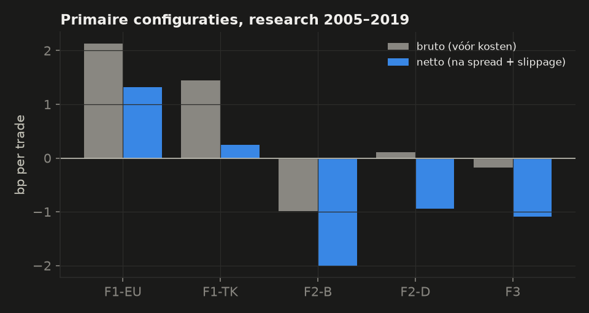
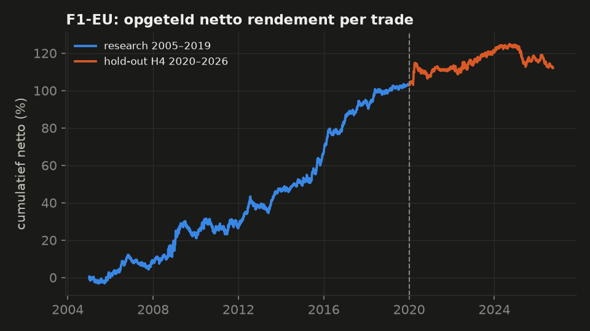
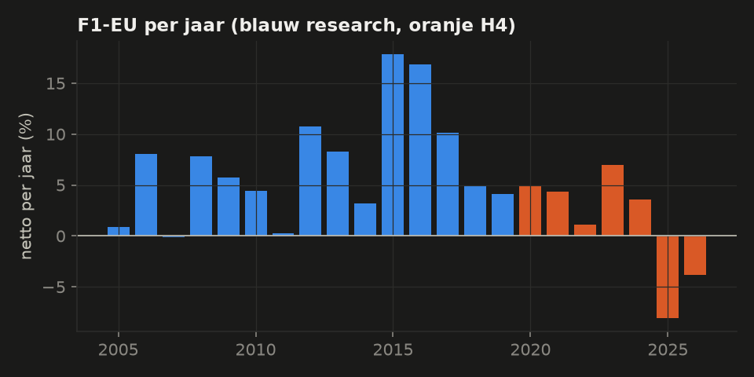
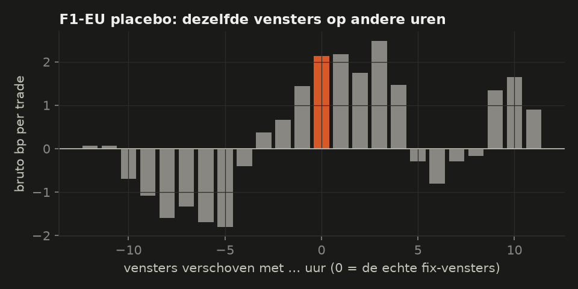

# Ronde 4: daytrade-patronen in valuta

*Research 2005–2019 op EUR/USD, GBP/USD en USD/JPY (Dukascopy 1h, bid én ask). Kopen op de ask, verkopen op de bid, plus 0,1 pip slippage per kant. Nooit een positie over 17:00 New York. Opzet vooraf vastgelegd in [PLAN4.md](PLAN4.md). 32 trials. Hold-out H4 (2020-01 – 2026-10) 1× geopend, alleen voor F1-EU. Alleen onderzoek: geen paper trading, geen Telegram, geen echt geld.*

## Oordeel in gewone taal

**Kort: één patroon bestond echt (de dollar rond de grote fixes), maar het is na de publicatie grotendeels verdwenen. De rest leverde na kosten niets op.**

- **F1-EU** (dollar long van 08:00 tot 14:00 Frankfurt, dollar short van 16:00 Londen tot 16:00 New York, op EUR/USD) is volgens de vooraf vastgelegde regels **validated**.
  - In research: +1,32 bp netto per trade (bruto 2,13), Sharpe 1,00, 7804 trades, positief in alle drie de subperiodes.
  - In H4 (2020–2026): **+0,26 bp** (bruto 0,71), Sharpe 0,24, maar 71% van de bootstrap-trekkingen > 0. Dat is statistisch niet van nul te onderscheiden. 2025 en 2026 waren verliesjaren; met gewone broker-kosten −0,64 bp.
  - **Hoe zeker: laag.** De H4-regel in PLAN4 eiste alleen een positief gemiddelde. Achteraf was dat te soepel. In ronde 5 is die eis daarom strenger gemaakt. F1-EU gaat niet naar paper trading zonder apart plan en akkoord.
- **F1-TK** (rond de Tokio-fix, USD/JPY): het patroon is er bruto (+1,45 bp), maar na kosten blijft +0,24 bp over, en bij 3× slippage is het negatief. Rejected.
- **Ronde getallen** (Osler 2003): de koers keert niet vaker bij 00-niveaus; bounce op echte ronde getallen was zelfs slechter dan op willekeurig verschoven niveaus (−2,01 bp). Breakout: −0,94 bp, niet beter dan het nulmodel. Rejected.
- **London breakout** (populair bij particulieren): −1,09 bp netto, niet beter dan willekeurige entries. Rejected.

## Waarom deze strategieën?

- **Fix-reversal:** Krohn, Mueller & Whelan (*Journal of Finance* 2024) vonden dat de dollar stijgt vóór de grote valutafixes en daarna daalt. Hun verklaring: dealers dekken de dollarvraag rond de fix af. De paper meldde ~2,5 bp per venster, vóór kosten.
- **Ronde getallen:** Osler (*JF* 2003) zag in echte orderboeken dat take-profit-orders óp ronde koersen liggen (daar zou de koers keren) en stop-losses er net voorbij (na doorbraak zou hij versnellen).
- **London breakout:** de bekendste daytradestrategie op forex-fora, zonder onafhankelijk onderzoek. Hier als controle.

## Resultaten

|  | trades | netto bp | bruto bp | kosten bp | Sharpe | bootstrap > 0 | 3× slip | retail | RC p | status research |
|---|---|---|---|---|---|---|---|---|---|---|
| F1-EU | 7804 | +1,32 | 2,13 | 0,81 | 1,00 | 100% | +1,00 | +0,53 | 0,00 | **candidate** |
| F1-TK | 7291 | +0,24 | 1,45 | 1,21 | 0,22 | 83% | −0,15 | −0,73 | 0,97 | **rejected** |
| F2-B | 2906 | −2,01 | −0,98 | 1,03 | −1,35 | 0% | −2,33 | −2,83 | 1,00 | **rejected** |
| F2-D | 2847 | −0,94 | 0,11 | 1,05 | −0,45 | 2% | −1,24 | −1,75 | 1,00 | **rejected** |
| F3 | 8334 | −1,09 | −0,17 | 0,92 | −0,65 | 0% | −1,38 | −1,83 | 1,00 | **rejected** |

*bp = basispunt = 0,01%. Netto = na de echte spread van dat uur plus 0,1 pip slippage per kant. Retail = +0,5 pip per kant extra, alleen ter informatie. RC p = Reality Check over alle 32 trials.*

### F1-EU: het fix-patroon

- Per been in research: dollar long vóór de ECB-fix +1,74 bp, dollar short na de Londen-fix +0,90 bp.
- Per been in H4: +0,86 bp en −0,34 bp. Het tweede been werkt niet meer.
- Hetzelfde patroon is bruto ook zichtbaar op GBP/USD (+1,91 bp) en zwakker op USD/JPY (+0,36 bp): het is een dollar-effect, geen EUR-effect.

*Placebo: dezelfde vensters, maar een aantal uur verschoven. Vlak rond de echte fix-tijden is het bruto positief, 5–10 uur eerder negatief. Dat past bij het W-patroon uit de paper.*

### Ronde getallen en London breakout

|  | netto bp | nulmodel 95e pct | echt op percentiel | grid netto > 0 |
|---|---|---|---|---|
| F2-B ronde getallen, bounce | −2,01 | +0,01 | 0e | 0% |
| F2-D ronde getallen, breakout | −0,94 | −0,44 | 48e | 0% |
| F3 London breakout | −1,09 | −0,38 | 46e | 0% |

*Nulmodel: F2 dezelfde regels op 200× willekeurig verschoven niveaus; F3 200× willekeurige entries met dezelfde stops en exits. Een echte strategie moet daar ruim boven liggen.*

## Wat dit betekent

- Echte intraday-patronen in valuta zijn klein: 1–2,5 bp per trade bruto. De kosten van een daytrade liggen rond 0,8–1,2 bp, zelfs bij de krappe spreads van Dukascopy. Bij een gewone broker blijft er niets over.
- Een gepubliceerd patroon werkt na publicatie minder (hier: van 2,1 naar 0,7 bp bruto).
- Populaire regels (ronde getallen, London breakout) doen het niet beter dan toeval.

## Kanttekeningen

- Alleen 1h-data (kleiner pas vanaf 2012), dus de ECB-fix (14:15) is afgerond op 14:00.
- USD/JPY 2010 ontbreekt bij de bron (jan–sep) en telt niet mee.
- Dukascopy-spreads zijn krapper dan bij de meeste brokers; zie de kolom retail.

Bestanden: [PLAN4.md](PLAN4.md), `research/round4/results/`, `research/round4/research_results.md` (alle 32 trials), code in `fx/`.