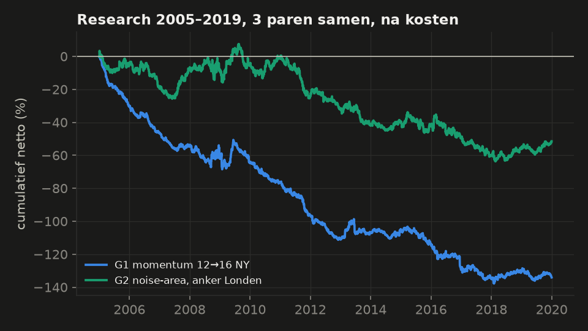
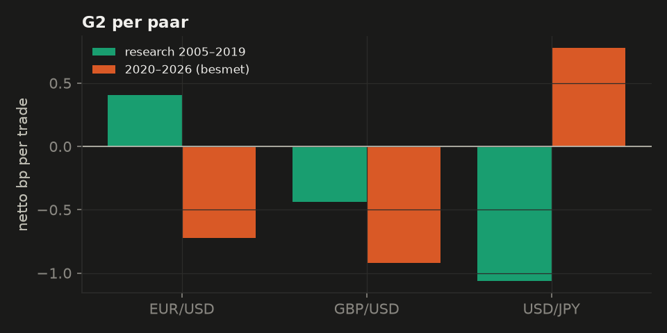

# Ronde 5: intraday momentum in valuta

*Research 2005–2019 op EUR/USD, GBP/USD en USD/JPY, met dezelfde data, kosten en engine als ronde 4. Opzet vooraf vastgelegd in [PLAN5.md](PLAN5.md). 6 trials. Bevestigingsblok C5 (AUD/USD, USD/CAD, USD/CHF) niet geopend, omdat er geen candidate was. 2020–2026 alleen beschrijvend.*

## Oordeel in gewone taal

**Kort: intraday momentum werkt in spot-valuta niet na kosten. Ook niet in de recente jaren waarin het bekend werd.**

- **G1 – momentum van de dag** (richting van 17:00 tot 12:00 NY vasthouden tot 16:00): −1,18 bp netto per trade, bruto −0,12. Niet beter dan willekeurig long of short (percentiel 26). Rejected.
- **G2 – noise-area breakout** (anker 08:00 Londen): −0,35 bp netto, bruto +0,56. De richting van de doorbraak voegt wél iets toe: hij scoort beter dan alle 200 willekeurige varianten. Maar de kosten (0,91 bp) zijn groter dan de winst. Rejected (bruto wel, netto niet).
- **2020–2026** (alle 6 paren, besmet, alleen beschrijvend): G1 −1,08 bp, G2 −1,00 bp netto; bruto rond nul. Het voordeel van G2 is daar ook bruto weg.

## Waarom deze strategieën, en waarom zo getest?

- De vraag was welke strategieën de afgelopen ~5 jaar het best werkten. Intraday momentum had daarvan de sterkste onderbouwing: Gao e.a. (JFE 2018), Baltussen e.a. (JFE 2021, ook valutafutures) en Zarattini, Aziz & Barbon (2024, de noise-area op SPY).
- **Probleem:** wie een strategie kiest omdát hij recent goed werkte, kan die recente jaren niet meer als toets gebruiken. Daarom: research op 2005–2019 (vóór de strategie bekend werd), bevestiging op drie andere valutaparen in dezelfde jaren, en 2020–2026 alleen als beschrijving.
- **Nulmodellen:** G1 met dezelfde vensters maar willekeurig gehusselde richtingen; G2 met dezelfde entrymomenten en houdduur maar een willekeurige richting. Zo meet je alleen wat het signaal toevoegt, los van tijd-van-de-dag-effecten (zoals het fix-patroon uit ronde 4).

## Resultaten

|  | trades | netto bp | bruto bp | kosten bp | Sharpe | bootstrap > 0 | nulmodel 95e pct | echt op percentiel | status |
|---|---|---|---|---|---|---|---|---|---|
| G1 | 11409 | −1,18 | −0,12 | 1,05 | −1,18 | 0% | −0,66 | 26e | **rejected** |
| G2 | 14651 | −0,35 | +0,56 | 0,91 | −0,34 | 8% | −0,46 | 100e | **rejected** |

| trial | trades | netto bp | bruto bp | Sharpe |
|---|---|---|---|---|
| `G1|12-16NY` | 11409 | −1,18 | −0,12 | −1,18 |
| `G1|14-16NY` | 11417 | −1,19 | −0,12 | −1,68 |
| `G2|ny17|m1.0` | 25001 | −1,29 | −0,26 | −1,72 |
| `G2|ny17|m1.5` | 16770 | −1,30 | −0,28 | −1,54 |
| `G2|london08|m1.0` | 14651 | −0,35 | +0,56 | −0,34 |
| `G2|london08|m1.5` | 9780 | −0,07 | +0,84 | −0,06 |

### 2020–2026 (besmet, alleen beschrijvend)

|  | trades | netto bp | bruto bp | Sharpe | EUR/USD | GBP/USD | USD/JPY | AUD/USD | USD/CAD | USD/CHF |
|---|---|---|---|---|---|---|---|---|---|---|
| G1 | 10504 | −1,08 | −0,08 | −1,52 | −0,34 | −1,00 | +0,07 | −2,36 | −1,60 | −1,25 |
| G2 | 14099 | −1,00 | −0,02 | −1,21 | −0,72 | −0,92 | +0,78 | −2,67 | −1,11 | −1,19 |

## Wat dit betekent

- In aandelen wordt intraday momentum verklaard door partijen die opties hebben verkocht en mee moeten handelen met de beweging. In spot-valuta is daar in deze data niets van te zien.
- Het doorbraak-idee (G2) heeft een klein echt voordeel in de richting, maar dat is kleiner dan de spread. Hetzelfde beeld als ronde 4: echte patronen bestaan, maar zijn te klein voor daytrading na kosten.
- De bevestigingsparen (AUD/USD, USD/CAD, USD/CHF) zijn nog ongezien en dus bruikbaar voor een volgende ronde.

Bestanden: [PLAN5.md](PLAN5.md), `research/round5/results/`, code in `fx/momentum.py`, `fx/run5.py`.